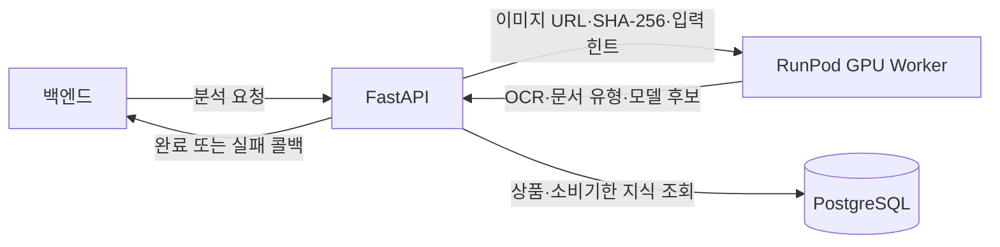

# 다먹자 FastAPI 서비스

레시피 추천은 확정 재고와 취향 태그를 별도 비동기 큐에 접수하고 HTTP 202와 jobId를 반환한다. PostgreSQL 원천/분량 검증, 승인 원천 보충, Gemma의 취향 적합 판단과 순위 조정 후 임박 재료를 분산 활용하는 최대 10개의 대안을 구성한다. 각 레시피에는 소비기한순 재고 ID별 사용량을 포함하며 실제 차감은 하지 않는다. 완료 결과는 조회 API와 레시피 전용 콜백으로 전달한다. 취향이 없으면 계절/시간대와 요청별 다양성 seed를 사용한다. 상세 계약은 [레시피 비동기 API](docs/recipe_async_api.md), 정책은 [AI 재고 활용 추천 설계](docs/recipe_ai_recommendations.md)를 따른다.

이 폴더는 다먹자 이미지 분석 시스템의 **제어 영역(control plane)** 이다. 백엔드의 분석 요청을
접수하고, GPU Worker의 모델 추론 결과를 서비스 데이터로 해석한 뒤, 최종 결과를 백엔드에
콜백으로 전달한다.

FastAPI 서버의 목적은 모델을 직접 실행하는 데 있지 않다. 요청 수명주기, 데이터 계약, 업무 규칙,
데이터베이스 조회와 장애 처리를 한곳에서 관리하여 모델 서버가 바뀌어도 백엔드 API 계약이 흔들리지
않도록 하는 것이 핵심이다.

## 시스템에서의 위치



FastAPI는 외부 백엔드와 GPU 추론 서버 사이의 경계다. 백엔드는 PaddleOCR, Gemma, YOLO 같은
모델 구성을 알 필요가 없고, GPU Worker는 재고 정책이나 백엔드 ERD를 알 필요가 없다.

## 주요 책임

### 분석 작업 수명주기

- `POST /ai/v1/analyses`로 요청을 접수하고 `analysisId`를 발급한다.
- 같은 `requestId`가 재전송되면 기존 작업을 반환해 중복 처리를 방지한다.
- 기본 100개의 인메모리 대기열과 제한된 수의 컨슈머로 순간 요청량을 흡수한다.
- 작업을 `QUEUED → PROCESSING → COMPLETED/FAILED` 상태로 관리한다.
- 처리 완료 후 백엔드 콜백 API로 최종 상태를 전달한다.

큐와 작업 저장소는 현재 단일 프로세스 메모리에 있다. 따라서 이 서비스는 Uvicorn worker 하나를
전제로 하며, 여러 EC2 인스턴스로 확장하려면 외부 큐와 공유 상태 저장소로 교체해야 한다.

### 추론 오케스트레이션

운영 구조에서는 이미지 바이트를 FastAPI가 GPU Worker로 다시 업로드하지 않는다. S3 서명 URL 또는
허용된 이미지 URL과 원본 SHA-256을 전달하고, Worker가 이미지를 직접 내려받아 무결성을 검증한다.

Worker 응답에는 입력 유형, OCR 텍스트와 좌표, 상품 후보와 신뢰도, 단계별 처리 시간과 모델 버전이
담긴다. FastAPI는 이 결과를 그대로 백엔드에 넘기지 않고 서비스 규칙과 DB 지식을 적용해 최종
응답으로 변환한다.

### 서비스 규칙과 데이터 보강

- OCR 좌표를 이용해 영수증의 상품명·수량·금액 행을 복원한다.
- 정규식 규칙, 상품 카탈로그 정확 일치, 유사도 검색, 모델 판단 순서로 식품 여부와 카테고리를
  결정한다.
- 수량과 중량·용량을 분리하고 고체는 g, 액체는 ml 단위로 정규화한다.
- 이미지에 소비기한이 보이면 확인된 값으로 사용한다.
- 날짜가 없으면 승인된 보관기간 지식으로 예상 범위를 만들고 `AI_ESTIMATED`로 표시한다.
- 근거가 부족하거나 결과가 충돌하면 값을 확정하지 않고 `NEEDS_REVIEW`로 남긴다.

PostgreSQL은 모델 추론을 대신하는 저장소가 아니라, 상품 별칭·카테고리·소비기한 근거처럼 검수된
지식을 제공한다. 조회 결과는 메모리 캐시로 재사용하되 최종 기준 데이터는 DB에 둔다.

## 요청 흐름

1. 백엔드가 `objectKey`, SHA-256, `inputHint`를 포함한 분석 요청을 보낸다.
2. FastAPI가 인증·요청 형식·멱등성을 검증하고 작업을 큐에 넣는다.
3. 컨슈머가 작업을 꺼내 GPU Worker에 원격 추론을 요청한다.
4. Worker가 입력 유형 분류, OCR, 상품 영역 검출과 Gemma 추론 결과를 반환한다.
5. FastAPI가 영수증 행 복원, 카탈로그 조회, 소비기한 정책과 응답 검증을 수행한다.
6. 결과를 `COMPLETED` 또는 `FAILED`로 저장한다.
7. 동일한 `analysisId`를 포함한 완료 콜백을 백엔드에 전송한다.

모델 장애처럼 일시적인 오류는 분석 그래프에서 한 번 재시도한다. 재시도 후에도 실패하면 실패 원인과
재시도 가능 여부를 구조화해 콜백한다. 콜백 전송 실패는 이미 완료된 분석 결과를 되돌리지 않으며,
제한된 횟수만 재시도하고 로그로 남긴다.

## 코드 구조

```text
fastapi/
├── app/
│   ├── main.py                 # 앱 조립과 생명주기
│   ├── runtime.py              # 큐, 컨슈머, 상태 전이, 콜백 실행
│   ├── analysis_graph.py       # 분석 실행과 재시도 흐름
│   ├── pipeline.py             # 추론 결과를 서비스 결과로 변환
│   ├── schemas.py              # 외부 API와 Worker 데이터 계약
│   ├── store.py                # 인메모리 작업 상태 저장소
│   ├── routers/                # 분석·헬스·모델 상태 API
│   ├── adapters/               # GPU Worker, DB, 콜백 연결부
│   ├── domain/                 # 영수증 행 복원과 도메인 규칙
│   └── logging/                # 비동기 날짜별 로그와 요청 감사 로그
├── database/
│   ├── migrations/             # 상품·소비기한 지식 스키마와 변경 이력
│   └── seed_data/              # 검수된 기준 데이터
└── docs/                       # 아키텍처·DB·운영 상세 문서
```

`routers`는 HTTP 계약만 처리하고, 작업 실행은 `runtime`, 업무 판단은 `pipeline`과 `domain`, 외부
연결은 `adapters`가 담당한다. 이 구분을 통해 API 명세, 모델 구현, DB 지식을 서로 독립적으로 바꿀 수
있다.

## 인증과 신뢰 경계

통신 방향마다 키를 분리한다.

| 통신 | 헤더 | FastAPI 설정 |
|---|---|---|
| 백엔드 → FastAPI | `X-Internal-API-Key` | `INTERNAL_API_KEY` |
| FastAPI → GPU Worker | `X-Worker-API-Key` | `REMOTE_INFERENCE_API_KEY` |
| FastAPI → 백엔드 콜백 | `X-Internal-API-Key` | `CALLBACK_API_KEY` |

FastAPI와 Worker가 공유하는 값은 FastAPI의 `REMOTE_INFERENCE_API_KEY`와 Worker의
`WORKER_API_KEY`다. 모든 실제 키는 배포 환경의 secret으로 주입하며 저장소에는 포함하지 않는다.

SHA-256은 인증키가 아니라 이미지 무결성 값이다. 백엔드가 저장된 이미지로 계산해 요청에 넣고,
Worker가 내려받은 이미지에 다시 계산하여 중간에 다른 파일로 바뀌지 않았는지 확인한다.

## 결과가 뜻하는 것

- `RECOGNIZED`: 이미지나 신뢰 가능한 지식에서 충분한 근거를 확보했다.
- `AI_ESTIMATED`: 상품은 확인했지만 날짜가 없어 검수된 보관기간으로 소비기한 범위를 계산했다.
- `NEEDS_REVIEW`: 인식 결과가 불완전하거나 근거가 충돌해 사용자 확인이 필요하다.
- `UNRECOGNIZED`: 의미 있는 상품 정보를 만들 수 없었다.

이 상태들은 모델의 자신감만 표현하는 값이 아니다. 이미지 근거, 카탈로그 일치 방식, 소비기한 정책을
함께 반영한 서비스 수준의 판단이다.

## 책임 범위 밖의 항목

- 레시피 검색과 레시피 DB 동기화
- 사용자 재고의 최종 저장과 수정
- GPU 모델 학습
- 이미지 원본의 영구 보관
- 사용자 검수 화면

FastAPI는 분석 후보를 만들고 전달하는 역할까지만 담당한다. 사용자가 확인한 값을 실제 재고로
확정하는 책임은 백엔드에 있다.

상세 상태 전이와 데이터 구조는 [아키텍처 문서](docs/architecture.md), DB 지식 구조는
[데이터베이스 문서](docs/database.md)에서 설명한다.

확정 재고 기반 레시피 추천·원본 저장·백엔드 동기화 구조는 [레시피 문서](docs/recipes.md)에서 설명한다.
