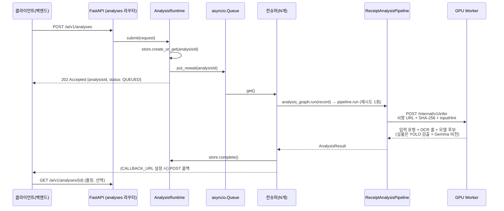

# 아키텍처

이 문서는 코드가 실제로 하는 일을 기준으로 쓴다.

## 한눈에 보기

- EC2 FastAPI는 요청 큐, 상태, PostgreSQL 참조 데이터, 후처리와 백엔드 콜백을 담당한다.
  모델은 실행하지 않는다. 이미지 서명 URL과 SHA-256을 RunPod GPU Worker에 한 번 보내
  MobileNetV3·PP-OCR·Gemma(실물은 YOLO-World 검출 포함) 결과만 돌려받는다. EC2 안에서 OCR·Gemma를
  돌리던 로컬 추론 모드는 2026-10-13에 제거했다.
- 파이프라인은 LangGraph 상태 그래프([app/analysis_graph.py](../app/analysis_graph.py))로 감싸
  실행한다. 노드는 분석 1개(`ReceiptAnalysisPipeline.run`)뿐이고, 재시도 가능한 실패
  (`retryable=true`)만 `ANALYSIS_RETRY_COUNT`(기본 1회)만큼 `ANALYSIS_RETRY_DELAY_SECONDS` 뒤
  다시 실행한다. 멀티스텝 에이전트가 아니라 재시도 래퍼로만 쓴다.
- FastAPI는 `uvicorn --workers 1`로 실행한다. 동시 처리는 프로세스를 늘리는 게 아니라 이
  프로세스 안의 컨슈머 태스크(`ANALYSIS_CONSUMER_COUNT`)로 한다.
  큐·분석 상태·결과는 프로세스 메모리에만 있고([app/store.py](../app/store.py)),
  재시작하면 사라진다.
- PostgreSQL(`receipt_ai` 스키마)은 상품 카탈로그·소비기한 규칙 같은 **보조 참조 데이터**만
  갖는다. 분석 이력·아이템은 이번 범위에서는 별도로 영속화하지 않는다 — 자세한 내용은
  [database.md](./database.md).
- 이미지 바이너리는 저장하지도 중계하지도 않는다. `objectKey` + `sha256`만 받아 Worker에
  서명 URL로 넘기고, Worker가 내려받아 해시를 검증한다.

## 요청 흐름



같은 `requestId`로 다시 요청하면 새로 큐에 넣지 않고 기존 `analysisId`를 그대로 반환한다
(멱등). 같은 `requestId`에 다른 이미지·조건을 보내면 `409 IDEMPOTENCY_CONFLICT`.

## 파이프라인 단계 ([app/pipeline.py](../app/pipeline.py))

`ReceiptAnalysisPipeline.run()`이 순서대로 실행한다(클래스명은 기존 호환 때문에 유지한다):

1. **GPU Worker 호출** — S3 10분 서명 URL(또는 개발용 `REMOTE_IMAGE_BASE_URL`)과 SHA-256을
   Worker에 보낸다. EC2가 이미지 바이트를 중계하지 않으며, Worker가 크기·픽셀·형식·SHA-256을 검증한다.
   Worker는 한 번의 호출로 아래 2·3번과 영수증 Gemma 후보(7-3번)를 모두 계산해 돌려준다.
2. **입력 유형 판별(Worker)** — `inputHint=RECEIPT/PRODUCT`면 명시 값을 우선한다. `AUTO`이면 추가 학습한
   MobileNetV3-Small이 `RECEIPT`·`PRODUCT`·`OTHER`를 예측하고, 최고 확률 0.8 이상이면서 1·2위 차이
   0.2 이상일 때만 채택한다. 기준 미달이면 아래 OCR 영수증 규칙으로 폴백한다.
3. **OCR(Worker)** — PP-OCRv5 Korean이 줄 단위 텍스트·좌표·신뢰도를 반환한다. 카드번호·전화번호는
   Worker와 EC2 양쪽에서 마스킹한다.
4. **OCR 폴백 문서 판정** — MobileNetV3가 확정하지 못한 `AUTO` 요청은 `receipt_likelihood()`([app/domain/receipt_rules.py](../app/domain/receipt_rules.py))가
   OCR 결과 안의 키워드("합계"/"금액"/"카드" 등), 가격 패턴(`1,000` 형식 숫자), 날짜 패턴
   개수로 0~1 점수를 매긴다. 이 단계는 학습 모델을 대체하는 규칙 기반 안전 폴백이다.
   점수가 0.45 미만이면 `documentType=OTHER`, 빈 `items`로 즉시 끝낸다. 단, 좌표로 상품행이
   4개 이상 복원되고 점수가 0.3 이상이면(가격 패턴은 있음) 영수증으로 인정한다 — 위·아래가 잘려
   "합계"·"카드"·날짜가 안 보이는 영수증을 살리기 위한 규칙이다(`_STRUCTURAL_RECEIPT_MIN_ROWS`).
5. **경로 분기 — 실물(`PRODUCT`)** — `remote`(GPU Worker)에서는 **실물 전용 비전 경로**를 쓴다.
   Worker가 YOLO-World(`yolov8s-worldv2`)로 포장 상품 위치를 검출하고(겹친 큰 박스·라벨 내부 박스
   제거), 개별 crop을 Gemma 비전에 전달한다. 전체 이미지 PP-OCR 좌표를 각 박스에 매칭해 crop별
   상품명 힌트로 붙이고(crop마다 OCR 재실행 안 함), 글자가 없는 포장은 YOLO 유형을 보조 힌트로 쓴다.
   검출 실패·검출기 비활성화 시 원본 이미지 한 장을 Gemma 비전에 넣는 경로로 폴백한다. 이렇게 얻은
   비전 후보는 `source=VISION`으로, OCR·카탈로그로 이미 고른 상품과 중복 제거(한글명 우선·유사도)
   후 합친다. Worker가 비전 후보를 주지 않으면 OCR 줄 + 상품 카탈로그로만 판별한다. 바코드 인식과
   비포장 단일 식재료 시각 분류는 아직 미구현이며, 근거가 없는 실물은 상품을 임의 생성하지 않는다.
6. **영수증 상품행 복원** — `build_receipt_product_rows()`가 좌표를 보고 상품명·수량·금액을 한 행으로
   묶는다. 상품번호가 있는 영수증(번호형)과 없는 영수증(이름형, 같은 줄에 수량·금액이 동시에
   있는 텍스트만 인정) 두 전략을 순서대로 시도한다.
7. **영수증 행별 카테고리 확정** — 각 후보 줄에 대해 순서대로 확인한다:
   1. `known_food_category()` — 정규식 기반 상비 키워드 목록. 맞으면 `source=BUSINESS_RULE`.
   2. DB 상품 카탈로그(`product_catalog_lookup`) — 정확 일치면 `source=CATALOG`, 정확
      일치가 없고 `pg_trgm` 유사도가 임계값을 넘으면 `source=CATALOG_FUZZY`(신뢰도는 유사도
      값을 그대로 쓰고 `NEEDS_REVIEW` 사유를 붙인다). `DATABASE_URL`이 비어 있으면 이 단계는
      건너뛴다.
   3. 위 두 단계로도 못 정한 줄은 Worker가 돌려준 Gemma 후보를 쓴다. `source=MODEL_INFERENCE`.
      Worker는 같은 행 복원으로 고른 줄에 "(수량 N개, 가격원)" 힌트를 붙여 Gemma에 보내고, OCR에
      없던 줄·상품은 원문 대조로 걸러낸다. Gemma 출력이 토큰 한도에서 잘리면(`done_reason=length`)
      2048토큰으로 한 번 다시 묻는다.
   - 티슈·화장지·봉투 같은 생활용품(`is_non_food()`)은 이 단계 전에 빠진다.
8. **검증·표준화** — 수량/용량 파싱(고체는 g, 액체는 ml), 소비기한 처리, `displayStatus`
   결정. 포장에 표시된 날짜만 `expiration.date`에 넣는다. 표시 날짜가 없고 확인된 구매일과
   보관기간 규칙이 있을 때만 `estimatedRange`를 반환하며 `date`는 비운다. 이 경우
   `AI_ESTIMATED`로 표시하고, 저품질 이미지·퍼지 카탈로그 매칭 등 더 높은 검토 사유가 있으면
   `NEEDS_REVIEW`로 올린다.
9. **완료** — 결과를 `store.complete()`에 저장하고, `CALLBACK_URL`이 설정돼 있으면 백엔드로
   POST 콜백을 보낸다. 없으면 클라이언트가 GET으로 폴링한다.

### 완료 콜백

콜백 본문은 백엔드가 소유한 "재고 인식 결과 콜백 API 명세"
(`POST /api/v1/internal/image-analyses/callback`, 헤더 `X-Internal-API-Key`)를 따른다. GET 조회 응답의
`result`를 [app/adapters/callback.py](../app/adapters/callback.py)의 `build_callback_payload()`가 평면
구조로 변환한다. 인식하지 못한 수량·중량은 `null` 대신 `0`(단위는 `NONE`)으로 보내며, 값의 출처와
확인 필요 여부는 `reviewReasons`로 전달한다.

| 콜백 필드 | GET 응답에서 가져오는 값 |
| --- | --- |
| `result.documentType` | `documentType.value` (`RECEIPT`, `PRODUCT`, `OTHER`) |
| `items[].name` | `name.value`, 비었으면 `name.normalizedValue`, 둘 다 없으면 `null` |
| `items[].category`·`storageType`·`measureType` | 각 값 그대로 |
| `items[].quantity` | `quantity.value` 그대로(`COUNT`·`WEIGHT` 모두). 규칙으로 정한 기본 수량(`BUSINESS_RULE`)도 사용자가 검토할 후보값으로 보낸다. 수량 객체가 없으면 `0` |
| `items[].displayStatus` | 그대로. 단 `COUNT`인데 수량이 `0`이거나 `WEIGHT`인데 중량이 `0`이면 `NEEDS_REVIEW` |
| `items[].weight` | `COUNT`이면 `{value: 0, unit: NONE}`, `WEIGHT`이면 `{value, unit}`. 중량을 읽지 못했거나 0 이하이면 `{value: 0, unit: NONE}` |
| `items[].expiration` | `date`, `dateType`, `estimatedRange`만 |
| `error` | 그대로 (`code`, `message`, `retryable`, `retryAfterMs`) |

`200`이 아니어도 `429`·`500`·`502`·`503`·`504`·연결 실패·타임아웃만 같은 본문을 재전송하고(최대 3회),
`400`·`401`·`409` 등은 재전송하지 않는다. 재전송은 분석을 다시 실행하지 않는다.

## 동시성과 메모리 관리

- **큐**: `AnalysisRuntime`([app/runtime.py](../app/runtime.py))이 `asyncio.Queue`(기본 용량
  100, `ANALYSIS_QUEUE_MAXSIZE`)를 갖는다. 실행 중인 작업과 별개로 대기 작업 100개를 저장하며,
  큐가 가득 찬 뒤 들어오는 신규 작업은 `429 AI_QUEUE_FULL`(재시도 가능)과 “현재 분석 작업량이
  너무 많습니다. 잠시 후 다시 시도해 주세요.”를 반환한다. 큐 항목은 이미지 바이트 없이
  `analysisId`만 들고 있어 가볍다.
- **컨슈머**: 기본 2개(`ANALYSIS_CONSUMER_COUNT`)가 같은 큐를 나눠 처리한다. EC2에서 겹치는 일은
  Worker 응답 대기와 DB 조회뿐이고, Worker가 OCR·Gemma를 내부 세마포어로 한 번에 하나씩 처리하므로
  값을 크게 늘려도 처리량은 늘지 않고 Worker 쪽 대기만 길어진다.
- **운영 주의**: `uvicorn --workers 1`을 반드시 유지해야 한다. worker를 여러 개 띄우면
  프로세스마다 별도의 큐·store를 가지게 되어 같은 `analysisId` 조회가 worker에 따라 다른
  결과를 낼 수 있다.

## 데이터 계약 ([app/schemas.py](../app/schemas.py))

### `Category` — 상품 카테고리 (AI가 이 목록 밖의 값을 새로 만들지 않는다)

| 값 | 의미 |
| --- | --- |
| `VEGETABLE` | 채소 |
| `FRUIT` | 과일 |
| `MEAT` | 육류 |
| `SEAFOOD` | 수산 |
| `DAIRY` | 유제품 |
| `TOFU_BEAN` | 두부·콩류 |
| `GRAINS_NOODLE` | 곡류·면 |
| `PROCESSED_FOOD` | 가공식품 |
| `SEASONING` | 양념 |
| `BEVERAGE` | 음료 |
| `OTHER` | 기타(식재료는 맞지만 위 10개 어디에도 속하지 않을 때만) |

카테고리 코드는 백엔드 API 명세와 같다(2026-10-08 `GRAIN_NOODLE`·`PROCESSED`·`ETC`에서 변경, 마이그레이션 016).
카테고리 `OTHER`는 입력 유형 `documentType.value=OTHER`(분석 대상이 아닌 이미지)와 이름만 같고 다른 필드다.

### `Source` — 카테고리·값을 어떻게 정했는지

| 값 | 의미 |
| --- | --- |
| `BUSINESS_RULE` | 정규식 상비 키워드(`known_food_category()`) |
| `CATALOG` | DB 상품 카탈로그 정확 일치 |
| `CATALOG_FUZZY` | DB `pg_trgm` 유사도 폴백(정확 일치 실패 시만) |
| `MODEL_INFERENCE` | Gemma가 판별 |
| `KNOWLEDGE_ESTIMATE` | 소비기한을 `shelf_life_rules`로 추정 |
| `USER_CONFIRMED` | 사용자가 직접 확정(현재 파이프라인에서는 생성하지 않음) |
| `VISION` | 실물 사진을 GPU Worker의 Gemma 비전 모델이 직접 보고 판별(실물 경로에서 생성) |
| `BARCODE` | 실물 바코드 근거(계약만 있고 아직 생성하지 않음) |
| `OCR` / `RECEIPT_LINE` | OCR 원문 그대로 |

### `DisplayStatus`

`RECOGNIZED` · `UNRECOGNIZED` · `NEEDS_REVIEW` · `AI_ESTIMATED`. 승인된 보관기간 규칙으로
예상 범위를 만든 항목은 `AI_ESTIMATED`로, 이미지 품질 문제나 퍼지 매칭 사유가 있는
항목은 우선순위에 따라 `NEEDS_REVIEW`로 반환한다.

### 상품명 필드 (`name`)

| 필드 | 영수증 | 실물 사진 |
| --- | --- | --- |
| `value` | OCR 상품명에서 행번호·가격·용량·기호만 뗀 이름. 모델·카탈로그 이름으로 덮어쓰지 않는다 | 비전 모델·카탈로그가 정한 상품명 |
| `normalizedValue` | 카탈로그 표준명 또는 Gemma가 제안한 정규화 이름 | `value`와 같음 |
| `evidenceText` | OCR 원문 그대로 | 해당 OCR 줄 또는 모델 생성 줄 |

영수증에서 Gemma가 `불향차돌떡볶이`를 `떡볶이`처럼 줄이는 문제가 있어 표시값은 OCR 원문을 보존한다
(위키 2단계 원칙). 실물 사진은 포장 OCR 조각보다 비전 모델이 이미지에서 읽은 이름이 정확해 정규화 이름을 쓴다.

### `documentType.value`

`RECEIPT`, `PRODUCT`, `OTHER` 중 하나다.

## 프로젝트 구조

```text
app/
├─ adapters/
│  ├─ callback.py         # 백엔드 완료 콜백 (httpx.AsyncClient 재사용)
│  ├─ remote_inference.py # GPU Worker 호출(S3 서명 URL 생성, 응답 검증)
│  ├─ product_catalog.py  # product_knowledge/product_aliases 조회(정확+유사도)
│  ├─ shelf_life.py       # shelf_life_rules 조회(부분 문자열 매칭)
│  └─ _cache.py           # LazyPool, BoundedAsyncCache(두 DB 조회가 공유)
├─ domain/
│  ├─ models.py           # 포트(인터페이스)와 도메인 타입
│  └─ receipt_rules.py    # 마스킹·행 복원·단위·날짜 규칙, receipt_likelihood()
├─ routers/
│  ├─ analyses.py         # 분석 접수·결과 조회 API
│  ├─ health.py           # liveness·readiness
│  └─ status.py           # 모델·큐·컨슈머 상태 API
├─ config.py               # 환경변수 설정(pydantic-settings)
├─ dependencies.py         # 인증·runtime·설정 의존성 주입
├─ error_handlers.py       # 공통 API 예외 응답
├─ logging/                # 비동기 UTC 날짜별 로그 + 요청·응답 audit 로그
├─ main.py                 # 앱 조립(build_runtime, create_app)과 lifespan
├─ pipeline.py             # 입력 유형 분기와 영수증·실물 분석 orchestration
├─ analysis_graph.py        # 파이프라인을 감싼 LangGraph 상태 그래프(재시도 전용)
├─ runtime.py               # 인메모리 큐 + 다중 컨슈머(analysis_graph.run 호출)
├─ schemas.py               # 요청·응답 계약, enum
└─ store.py                 # 인메모리 상태·결과 저장소(TTL·최대개수로 제한)
```

## API

| Method | Endpoint | 역할 |
| --- | --- | --- |
| `POST` | `/ai/v1/analyses` | 영수증·실물 분석 접수, `202 Accepted` |
| `GET` | `/ai/v1/analyses/{analysisId}` | 작업 상태와 결과 확인 |
| `GET` | `/ai/v1/models/status` | GPU Worker 준비 상태(`remoteInference`), 큐 크기·용량, 동시 처리 수(`activeCount`) |
| `GET` | `/health/live` | 프로세스 생존 확인 |
| `GET` | `/health/ready` | 모델 포함 준비 상태 확인 |

결과 조회의 `items[].reviewReasons`는 프론트가 문자열을 해석하지 않고 확인 대상 필드를 바로
표시할 수 있도록 `field`, 안정적인 분기 코드인 `code`, 사용자 표시 문구 배열인 `messages`로
구성한다. 예시는 다음과 같다.

```json
{
  "field": "EXPIRATION",
  "code": "EXPIRATION_NOT_FOUND",
  "messages": ["영수증에서 확정 가능한 소비기한을 찾지 못했습니다."]
}
```

완료 콜백의 `items[].reviewReasons`도 결과 조회와 동일한
`{field, code, messages}` 객체 배열로 전달한다. 백엔드는 별도 조회 없이 콜백만으로
항목별 확인 사유를 저장하고 프론트엔드에 전달할 수 있다.

`inputHint=PRODUCT`는 실물 경로를 사용한다. `remote`(GPU Worker)에서는 YOLO-World 검출 + Gemma
비전으로 포장 상품을 판별하고(`source=VISION`), `local`에서는 OCR·카탈로그만 쓴다. 바코드와 비포장
단일 식재료 시각 분류는 아직 없으므로, 그런 사진은 근거 없이 상품을 임의 생성하지 않는다.

## 로깅

`analysisId`/`requestId` 기준으로 `queued → dequeued → remote_inference → document_checked
→ rows.reconstructed → classification → validation → completed/failed → callback` 순서를 추적한다.
이미지 bytes와 OCR 원문은 일반 로그에 남기지 않는다. 콜백 장애 추적을 위해 백엔드로 보낸 상품 후보
요약은 기록하며, 세부 기준은 [deployment.md의 로그 기록 정책](./deployment.md#로그-기록-정책)을 따른다. 모든 HTTP 요청·응답은
`X-Request-ID`(없으면 서버가 생성한 `traceId`) 기준으로 감사 로그 두 줄을 남긴다.
