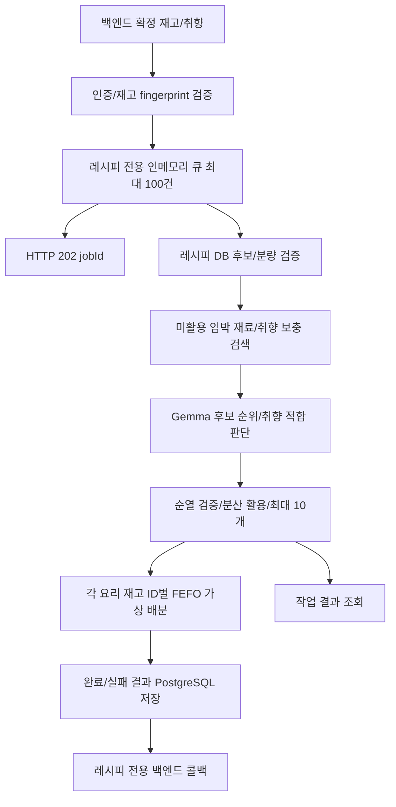

# 냉장고 레시피 추천 설계 v12

## AI 입력/취향 근거와 처리시간

AI에는 각 재료의 이름/역할/분량 판정 상태/계열 확인 힌트와 원문 조리 2단계의 각 80자를 보낸다. 이미 FastAPI가 계산한 수량을 다시 추론시키지 않으므로 원문 수치/역할 설명의 반복 전송과 전체 재고의 카테고리/중량 필드를 줄인다. ingredientColumns가 압축 배열의 열을 설명하고 생략 표시를 함께 보낸다. 공개 ingredients/steps/amountText/inventoryUsage는 줄이지 않는다.

입력 크기는 실제 HTTP JSON처럼 공백 없는 UTF-8 직렬화로 검사한다. RECIPE_AI_INPUT_MAX_BYTES 기본 16000바이트/최대 24000바이트다. 초과하면 AI 평가 창만 줄이고 AI_INPUT_WINDOW_REDUCED를 표시한다. AI가 보지 않은 후보는 UNKNOWN이며 원래 후보 목록과 최대 10개 추천 정책은 유지한다. 단일 후보도 담을 수 없는 비정상적 입력은 기본 추천으로 돌아간다.

Worker 계약 recipe-grounded-v5는 취향 적합 ID마다 원문 인용 preferenceEvidence를 요구한다. 같은 순열을 모든 취향의 적합 ID로 복사하지 않도록 지시한다. FastAPI는 인용문이 실제 전송한 제목/재료/조리 구절인지 검증한다. 알려진 매운맛 태그는 명시적인 매운 근거를 요구하고, 담백한/안 매운 태그와 명시적 매운 근거가 충돌하면 확인 상태로 둔다. 거부한 적합 주장은 UNKNOWN과 AI_PREFERENCE_EVIDENCE_REJECTED로 표시한다. 이 검사는 주관적인 맛의 정확도나 알레르기 안전을 보증하지 않는다.

trace의 aiInputBytes/aiCandidateCount는 마지막 시도한 AI 입력의 크기/후보 수다. timingsMs는 databaseSearchMs(DB 조회), initialCandidateEvaluationMs(초기 필터/분량/기본 정렬), aiRankMs(슬롯/원격 탐색/모델 호출/응답 검증 대기), recommendationMs(추천 생성 전체)를 기록한다. 서로 독립적인 합산 항목이 아니며 전체 시간에는 앞 항목들이 포함된다. 큐 대기/콜백 전달/최종 작업 DB 저장은 이 추천 생성 시간 밖이다. 순수 GPU 시간과도 구분한다. 캐시 결과는 원본 생성 당시 측정값이다.

원문 인분/분량 미상은 값을 지어내지 않고 SOURCE_SERVINGS_UNAVAILABLE / SOURCE_QUANTITIES_UNRESOLVED로 알린다. 정확한 인분/분량 원천이 확보돼야 사용량 계산 범위를 늘릴 수 있다. 이 변경에는 새 SQL이 없다.

## 정책

추천의 기본은 3일 이내 소비기한의 재료 활용이다. 임박 재료끼리, 임박 재료와 여유 재료를 조합할 수 있다. 임박 재료가 없어도 여유 재고로 추천한다. 요청에 USE_EXPIRING이 없으면 서버가 추가하며 이 전략을 요청했다고 비임박 후보를 제거하지 않는다.

확정 재고의 기본 식재료 키와 검토된 별칭으로 원천을 찾는다. 상품명은 검토 사전으로 연결하고 ingredientKey가 있으면 우선한다. 순두부/두부, 고기 부위, 가공 상태를 임의로 같다고 보지 않는다. 재고 ID와 상품명은 공개 사용량에 유지한다.

물과 검토된 양념/조미료는 부족 식재료와 구매 부담에서 제외한다. 원문 분량은 삭제하지 않으며 PANTRY_UNVERIFIED는 실제 보유량을 보증하지 않는다. 마늘/생강처럼 냉장고의 신선 재료가 요리의 주재료인 경우는 실제 재고 확인 대상으로 유지한다. 미검토 소스를 양념이라고 추측하지 않는다. 제외 재료는 조미료라도 우선 적용한다.

quantityScope=FOOD_INGREDIENTS이며 전체 quantityStatus는 PANTRY_UNVERIFIED인 양념/물을 제외한 식재료 기준이다. 식재료가 충분하면 QUANTITY_VERIFIED여도 양념/물의 보유량까지 검증했다는 뜻은 아니다. 개별 ingredientRequirements에는 양념의 미확인 상태를 그대로 남긴다.

보유 식품을 최소 하나 실제 연결한 요리는 다른 재료가 부족해도 NEEDS_SHOPPING으로 추천한다. 같은 계열 힌트만 있고 실제 보유 식품이 연결되지 않으면 confirmationCandidates에 분리한다. 재료/분량/조리 단계는 원문을 보존한다. 최대 10개의 서로 다른 원천 레시피를 추천하며 적합 후보가 충분하면 10개를 목표로 한다. 없으면 미만 또는 빈 배열이다.

## 취향과 무취향

- preferenceTags는 사용자별 설문에서 받은 문자열 배열이다. 예: ["매운거","칼칼한거"]. 선호 태그이며 알레르기 안전 필터가 아니다. 식품 제외는 excludedIngredientNames를 따로 사용한다.
- Gemma에 확정 재고, 임박 ID, 태그와 검증 후보를 전달한다. 모델은 원문에서 취향 적합의 근거가 있는 후보 ID만 preferenceMatchedCandidateIds로 반환한다.
- 후보의 preferenceMatch는 MATCHED / NOT_MATCHED / UNKNOWN / NOT_REQUESTED다. 모델 미호출/실패나 평가 범위 밖 후보를 맞춤 추천이라고 주장하지 않는다.
- 원천 DB 후보 중 AI 평가 창에 취향 적합 결과가 없으면 Tavily 전체 웹 검색에서 검증한 원천을 태그와 임박 재료로 보충하고 다시 평가한다. 평가 창 밖까지 포함한 전체 DB에 해당 요리가 없다고 단정하지 않는다.
- preferenceTags=[]이면 서버의 한국 시각 기준 계절과 식사 시간대를 참고한다. 계절은 3~5월 봄, 6~8월 여름, 9~11월 가을, 12~2월 겨울이다. 시간대는 05~10시 아침, 11~15시 점심, 16~21시 저녁, 나머지 야식이다.
- requestId에서 만든 variationSeed로 동등한 후보의 순서를 섞는다. 같은 requestId 재시도는 같은 작업이며, 새 추천은 새 requestId다. 새 요청이 항상 다른 목록을 보장하는 것은 아니다.
- 계절/시간대는 추천 방향이며 제철, 영양 효과, 사용자 위치나 실제 식사 시간을 추측하지 않는다. 응답 context에 적용한 시각 기준과 모드를 표시한다.

## 순위와 조합

1. 정확 매칭한 임박 주재료 활용, 임박 부재료만 활용, 임박 미활용 순으로 그룹을 둔다.
2. 같은 그룹에서 분량/재료 적합성 단계를 보호한다.
3. 최종 선택에서 아직 쓰지 않은 임박 주재료의 대표 후보를 먼저 검토한다. 구매 부담은 같은 그룹 최소 부족 재료 수 + 2종 이내로 제한한다. 이 2종은 명시적인 초기 정책값이며 최적값으로 실증된 수치는 아니다.
4. 새로운 임박 재료의 빠른 소비기한, 추가 임박 재료 수, 취향 적합, 부족 재료 수를 비교한다. 이후에는 AI/기본 순서를 유지한다.
5. 같은 조건에서 최근 추천과 동일 주재료 반복을 고려한다. recentRecipeIds는 백엔드가 SOURCE:sourceRecipeId 형식으로 전달한다.
6. 최종 목록의 MAIN 활용을 기준으로 uncoveredExpiringIngredients를 다시 계산한다. 전체 후보에서 발견됐어도 최종 목록에서 빠졌으면 미활용이다.

Gemma는 기본 최대 20개 후보의 순열과 취향 적합 ID만 반환한다. 모델은 후보/날짜/분량을 만들거나 원문을 바꾸지 않는다. AI 순서와 최종 순서는 같지 않을 수 있다. 코드가 임박/적합성/분산 활용 조건을 적용하며 AI 평가 창 밖의 후보가 선정되면 AI_RANKED_PREFIX_ONLY를 표시한다. score는 규칙 점수이며 AI 신뢰도나 최종 순위 점수가 아니다.

## 재고 ID별 사용량

quantities.py는 원문 기준 인분과 확정 분량이 있을 때 필요량을 계산하고, 같은 재료/단위의 재고를 소비기한 ASC, 같은 날짜는 ingredientId ASC로 배분한다. 예를 들어 당근 350g이 필요하고 ID 1의 오늘 임박 당근이 100g, ID 2가 300g이면 ID 1에서 100g, ID 2에서 250g을 사용한다.

각 추천의 inventoryUsage에 재고 ID, 원래 상품명, EA/G/ML 단위, 보유량, 사용량, 잔량과 allocations를 함께 반환한다. allocations는 레시피 ingredientNo와 사용량을 연결한다. COUNT와 G를 자동 환산하지 않는다. 인분/분량 미상이나 단위 불일치는 allocationStatus=UNRESOLVED이며 usedAmount=0을 실제 불필요/미소비 확정으로 읽지 않는다. 계산된 경우 CALCULATED, 관련 배분이 없는 재고는 UNUSED다.

10개 레시피는 독립적인 선택지다. 각 레시피는 같은 입력 재고로 개별 계산하며 합쳐서 10개를 만들 수 있다는 뜻이 아니다. 실제 재고 차감은 수행하지 않는다. 사용자가 하나를 선택할 때 백엔드가 현재 재고/fingerprint와 수량을 재검증한 뒤 차감한다.

## 검색과 원천

AI PostgreSQL ACTIVE 원천을 먼저 조회한다. 전체 후보에서 임박 주재료를 활용하지 못하거나 일반 후보가 없으면 식품안전나라의 승인된 원천을 보충하고, 그래도 부족하면 Tavily를 사용한다. 취향을 평가한 후보가 맞지 않을 때도 태그를 포함해 Tavily 보충을 시도한다. 웹 보충은 한 추천 실행에서 최대 한 번의 검색 묶음, 최대 2개 초점 재료다.

TAVILY_API_KEY가 있으면 전체 웹 검색을 수행한다. RECIPE_TAVILY_APPROVED_DOMAINS는 검색 제한이 아니라 원천 DB 등록/재사용 승인 호스트 목록이다. 빈 목록도 검색을 막지 않는다. 검증된 웹 후보는 이번 추천에서 사용할 수 있으나 미승인 원천은 recipes/changes에 등록하지 않고 WEB_SOURCE_NOT_REGISTERED로 표시한다. 완료 작업 결과 스냅샷에는 추천 본문이 보관되므로 무저장 모드는 아니다. 검색 성공은 이용 조건 확인이나 원문 재배포 승인을 의미하지 않는다. 검색에는 재료/취향만 보내고 냉장고 ID, 재고 ID, 수량, 이미지 URL은 전달하지 않는다.

단일 schema.org Recipe 또는 명시적인 Markdown 재료/조리 구획만 파싱하고 원문, 재료, 단계와 인분을 검증한다. 서버가 검색 URL에 직접 접속하지 않고 Tavily 응답을 검증한다. 불완전 자료를 LLM으로 채워 정상 레시피로 저장하지 않는다. sourceUrl과 원문 revision을 보존한다. 웹 보충 실패 시 기존 추천을 유지한다.

Markdown 제목 외에 [재료], 굵은 재료소개/만드는 법도 인식한다. 블로그 메뉴 제목 대신 검색 결과 제목을 활용한다. 규칙으로 읽지 못한 본문은 기존 원격 Gemma의 EXTRACT 단계에 최대 2건 전달한다. 각 시도는 슬롯 대기 포함 Worker 15초/호출자 16초 상한이며 외부 보충 전체 예산 안에서만 실행한다. DB 후보 RANK에 걸린 시간은 외부 보충 예산에서 중복 차감하지 않으며 전체 AI 잔여 예산은 별도로 제한한다. 본문은 정리 후 최대 24,000바이트로 제한하며 넘으면 조용히 자르지 않고 거부한다. 별도 GPU 모델은 추가하지 않는다.

EXTRACT는 재료별 name/quote와 원문 조리 구절만 반환한다. FastAPI는 실제 본문 포함 여부, 순서, 중복 재료 인용과 명시된 번호 단계 누락을 검증한다. 원문 파서가 읽은 전체 재료명과 수량을 우선하므로 모델이 다시마로 줄였더라도 원문의 다시마 작은 조각을 보존한다. g/ml/개는 기존 단위 파서로 계산하고 스푼 등 미지원 단위는 원문을 보존한 UNKNOWN이다. 인분은 원문에 하나의 값으로 명시된 경우만 사용한다. 대량 양념의 소분/여러 번 사용, 배수 조리가 섞인 경우 MIXED_BATCH로 제외한다. 모델 출력의 원문 일치가 전체 레시피의 완전성이나 요리 안전성을 보증하지는 않는다.

trace에 webDiscoveredCount, webExtractionCalls, webParseFailureCounts를 추가한다. aiCalls는 RANK와 EXTRACT의 합계이며 timingsMs.webExtractionMs는 모델 호출 대기를 포함한다. EMPTY_BODY, MIXED_BATCH, INGREDIENT_SECTION_NOT_FOUND, STEP_SECTION_NOT_FOUND, INGREDIENT_OR_STEP_VALIDATION_FAILED, EXTRACTION_INPUT_TOO_LARGE, MODEL_SOURCE_EVIDENCE_REJECTED, MODEL_EXTRACTION_UNAVAILABLE 등을 구분해 기록한다. 검색 결과 원문과 키는 로그에 복제하지 않는다. EXTRACT 실패는 기존 추천을 유지하며 FastAPI와 Worker를 함께 배포해야 한다.

## 비동기 구조

POST/GET/콜백 계약은 [레시피 비동기 API](recipe_async_api.md)를 따른다. 사진 분석 큐와 라우터/콜백을 공유하지 않으며 기존 영수증 요청/응답은 변경하지 않는다.

## 운영

- FastAPI 정책 recipe-rerank-v12와 Worker recipe-grounded-v5를 함께 배포한다. 구 Worker는 프로토콜 불일치로 AI 결과를 수용하지 않고 기본 추천으로 돌아간다.
- 큐는 프로세스 메모리이며 소비자 기본 2개, 최대 4개다. GPU Worker는 사진과 동일 모델/LLM 세마포어를 사용하므로 완전한 자원 격리는 아니다.
- 작업 처리 상한은 기본 120초이며 큐 대기는 별도다. 각 RANK 슬롯 대기/호출은 RECIPE_AI_RANK_TIMEOUT_SECONDS 기본 20초와 전체 AI 예산 잔여시간 중 작은 값으로 제한한다. 취향 웹 보충 후 재평가하면 RANK는 최대 2회다.
- 원격 장애는 프로세스 내 30초 호출 쉬기를 적용한다. 오류가 아닌 의도적 AI 비활성은 기본 추천으로 동작한다. AI 실패/불확실한 취향은 경고와 preferenceMatch로 구분한다.
- 메모리 결과 기본 1시간/최대 2000건이며 terminal 결과는 022 테이블에 보관한다. DB 보존 기간/삭제는 별도 운영 정책이다.
- 인메모리 큐/멱등 접수는 단일 FastAPI 프로세스와 단일 replica 기준이다. 여러 ECS replica로 늘리면 공용 큐/멱등 예약 구조가 필요하다.
- 정상 종료는 남은 작업을 FAILED로 표시하고 저장/콜백을 최대 10초 동안 시도한다. 프로세스 강제 종료에서는 미완료 작업이 소실될 수 있다. 완료 결과는 DB에서 재조회할 수 있지만 큐 재개나 콜백 자동 재전송을 보장하지 않는다.
- 같은 requestId와 같은 본문은 같은 작업, 다른 본문은 409다. 새 재추천/실패 후 새 시도는 새 requestId를 사용한다.
- 추천 캐시는 요청 ID/태그/인분/재고/fingerprint/정책/서울 날짜/공급자 설정으로 분리한다. trace는 원본 생성 당시 호출 수다.
- recipe.job / recipe.callback 로그로 작업 ID를 추적한다. /metrics의 dameokja_recipe_*는 접수, 큐, 대기, 처리, 성공/실패와 콜백을 제공한다. GPU 사용률 자체를 나타내는 지표는 아니다.
- API 성공, 원문 파싱 성공과 실제 추천 품질은 별도다. 검증은 임박 활용, 추가 구매 부담, 재고 ID 배분, 취향 적합, 원문 보존을 구분한다.
