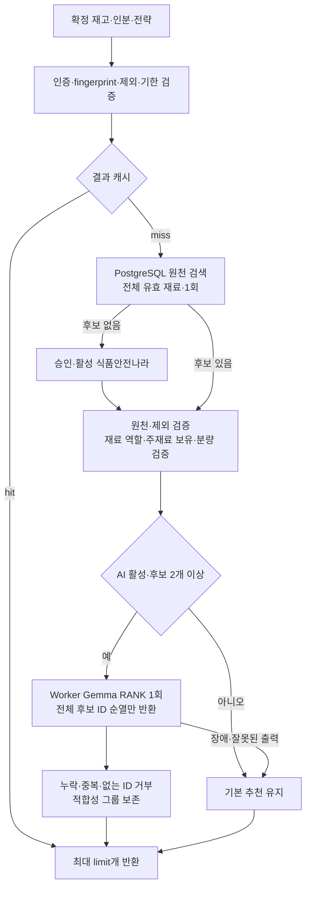

# 냉장고 레시피 추천 — 적합 후보 우선·단일 AI 순위 조정 정책 v5

## 목적과 흐름

검증된 원천 레시피를 재고와 비교해 기본 추천을 먼저 만든다. AI는 후보를 생성·제거하지 않고 임박 재료 활용·구매 부담·조리 수고를 고려해 순서만 조정한다. 날짜·분량·제외 조건은 코드가 검증한다.

첫 PLAN 호출과 초점 재료 재검색은 하지 않는다. 캐시 미스에서 DB 검색은 1회, AI 호출은 최대 1회다. AI 실패가 기본 후보나 추천 개수를 없애지 않는다.

## Tavily·외부 조회의 실제 범위

- 사용자 추천 API는 Tavily·TheMealDB를 자동 호출하지 않는다.
- DB에 후보가 없을 때만 승인·활성화된 식품안전나라 공급자를 호출한다. 키만 넣어도 저장 승인이 자동 활성화되지는 않는다.
- 공급자 미설정 시 기존 503 의존성 오류 계약을 유지한다.
- TavilyDiscovery와 database/discover_recipe_sources.py는 별도의 원천 조사 도구다. 제목·URL만 검토 대기 후보로 수집하며 원문·이미지를 크롤링하거나 DB Recipe로 자동 승격하지 않는다.
- 따라서 검색 키가 있다는 사실과 사용자 요청에서 검색한다는 것은 다르다. Tavily 자동 폴백은 원문 이용·반입 정책과 응답 계약을 정한 뒤 연결할 후속 범위다.

## 기본 적합성·AI 역할

- ACTIVE 원문, 실제 보유 재료와 교집합, 제외 조건을 통과한 후보만 사용한다. 제외 부분 문자열 검사는 알레르기 안전 보증이 아니다.
- 점수에는 임박 재료 활용·보유 재료 비율·부족 재료·제목 명시 누락 재료가 반영되지만, 점수가 0이라는 이유만으로 적합 후보를 제거하지 않는다. 보유 주재료가 있고 양념·부재료만 부족한 요리를 감점 때문에 놓치지 않기 위해서다. 원천 ID 중복을 제거한다.
- `suitability.py`는 재료 역할을 MAIN/SIDE/SEASONING/WATER/UNKNOWN으로 구분한다. 제목 근거가 우선하며, 그 외는 코드의 명시적 검토 목록만 사용한다. UNKNOWN을 자동으로 양념이나 부재료로 취급하지 않는다. 역할은 내부 판단 자료로만 쓰며 원문 스냅샷에 새 필드를 저장하지 않는다.
- 주재료가 정확히 없고 같은 계열 재고도 없거나, 역할 미검토 재료가 미보유이면 기본 후보에서 제외한다. 물·양념만의 재고 교집합으로 요리를 추천하지 않는다. 적합 후보가 없으면 EMPTY이며, 구매할 주재료가 많은 요리로 10개를 채우지 않는다.
- 그룹은 0=정확한 재료·수치 충족, 1=재료 보유·분량 확인 필요, 2=부재료·양념 추가 필요, 3=주재료 분량 부족 또는 같은 계열만 있어 확인 필요다. AI는 그룹 순서를 뒤집지 못한다. 미검토 목록이 넓으면 후보가 과도하게 줄 수 있으므로 제외 지표를 보고 검토 목록·원천 메타데이터를 개선해야 한다.
- 제목 연결은 통오징어→오징어와 쇠고기안심→소고기 등 검토된 관계만 사용한다. 같은 계열은 대체·정확 보유·조리 상태·분량 환산의 증거가 아니다. 소고기가 있어도 쇠고기안심의 배분량은 늘리지 않으며 부족 재료와 확인 필요 사유를 그대로 표시한다.
- essentialIngredientNos는 제목 및 검토 규칙으로 MAIN인 원문 재료 번호다. missingEssentialIngredientNos는 그중 정확 보유가 확인되지 않은 번호다. 모든 요리의 주재료를 완전하게 식별했다는 보장은 아니다.
- USE_EXPIRING만 요청하면 실제 임박 재료를 쓰는 후보만 남긴다. 복수 전략은 임박 활용·구매 최소·간편 조리를 순위 판단 입력으로 사용한다. 모든 전략이 반드시 한 개씩 나오는 것은 아니다.
- SIMPLE_COOKING만 요청하면 적합성 그룹이 같은 경우 원문 단계 수가 적은 후보를 먼저 표시한다. 단계 수가 실제 조리시간을 보증하지 않는다.
- 물을 제외한 보유하지 않은 원문 재료가 있거나 분량이 부족하면 NEEDS_SHOPPING이다. 같은 계열 재고가 있어도 정확한 재료가 없으면 구매·확인 필요를 유지한다. 수치상 충족만 QUANTITY_VERIFIED이며, 해동·기구·식품 안전 보증은 아니다.
- RANK는 최대 후보 상한(기본 12개)의 candidateId 전체를 정확히 한 번씩 반환한다. 프롬프트가 아니라 Worker JSON Schema와 서버의 순열 검증을 모두 적용한다.
- AI는 새 요리·재료·날짜·분량·조리 시간을 만들거나 원문을 수정하지 않는다. 표시 reason은 검증된 사실로만 구성한다.

AI 입력은 재고·전략·임박 정책과 압축 후보다. 원문 재료별 분량 판정과 보유·부족·임박·제목 명시 누락 정보를 전달한다. 조리문은 첫 2단계·단계당 100자로 제한하고 생략 여부를 표시한다. 24,000바이트 초과 시 세부 수치·조리문부터 줄인다. 그래도 초과하면 후보를 잘라 없애지 않고 기본 추천으로 폴백한다. 최종 ingredients/steps/baseServings/sourceRevision은 그대로 반환한다.

## 분량과 재고

- 정확 이름·검토된 재고 별칭과 같은 EA/G/ML끼리만 계산한다. 1모→g, 큰술→ml, g→ml을 추측하지 않는다.
- 원문 인분·수치가 없으면 UNKNOWN_AMOUNT/null을 유지한다. 원문 분량을 임의로 1인분으로 간주하지 않는다.
- 같은 재료의 중복 행을 각각 계산하며 소비기한이 가까운 재고 ID부터 가상 배분한다.
- ingredientRequirements는 원문·필요량·배분·부족량, inventoryUsage는 available/used/remaining이다.
- 각 추천을 단독 선택하는 독립 대안이며 실제 차감이나 여러 요리 동시 조리 계획이 아니다.
- 물은 기본 가용 정책으로 구매 필요에서 제외하며 냉장고 재고로 임박 가산하지 않는다. 물의 보유량은 보증하지 않으므로 분량은 PANTRY_UNVERIFIED이며 그 때문에 QUANTITY_VERIFIED로 승격하지 않는다. 원문 물 분량은 보존한다. 육수·소금물·물전분·우유를 물로 취급하지 않는다.
- 조미료는 냉장고와 별도인 pantryIngredientNames로 명시한 검토된 SEASONING만 보유로 참고한다. 분량은 PANTRY_UNVERIFIED다. 소고기 등 주재료를 pantry에 넣어 보유 검증을 우회할 수 없고, 미검토 이름은 무시하고 경고한다. 원문 양념 분량·전체 조리문은 삭제하지 않는다.

## API·운영 계약

POST /ai/v1/recipe-recommendations의 인증과 요청·응답 필드 형태는 유지한다.

- limit 기본 10, 범위 1~20. 검증된 기본 후보가 부족하면 그 미만을 반환한다.
- recommendationEngine=AI는 AI 순위 조정이 검증됐다는 뜻이다. AI가 레시피를 생성하거나 섭취 안전을 승인했다는 의미가 아니다.
- RULE_FALLBACK은 AI 비활성·생략·실패 시 기본 추천임을 표시한다. 후보 1개에서는 불필요한 모델 호출을 하지 않는다.
- EMPTY는 유효 재고·기본 적합 후보가 없음을 뜻한다.
- mealPlan은 이전 응답 호환을 위해 빈 focusIngredientIds/ideas로 유지한다. 별도 AI 계획은 만들지 않는다.
- trace.policyVersion=recipe-rerank-v5, aiCalls=0 또는 1, searchCount=0 또는 1. candidateCount는 역할 필터 전의 원천 조회·제외 검증 통과 수다. 실제 추천 수와 다르다.
- score/scoreBreakdown은 코드의 후보 점수이지 AI 신뢰도나 최종 순위 점수가 아니다.
- AI 대상보다 limit가 크면 AI가 정렬한 후보 뒤에 검증된 기본 후보를 유지하며 AI_RANKED_PREFIX_ONLY로 범위를 명시한다.
- 기존 Worker 주소 탐색과 X-Worker-API-Key 인증으로 POST /internal/v1/recipes/reason stage=RANK를 호출한다. Worker의 PLAN/SELECT 수용은 배포 전환 호환용이며 현 추천 경로는 사용하지 않는다.
- 미지원 구버전 Worker는 기본 추천으로 폴백한다. 새 동작의 실측은 FastAPI와 Worker를 함께 배포한 뒤 수행해야 한다.
- RECIPE_AI_ENABLED=true, RECIPE_AI_TIMEOUT_SECONDS=45초, RECIPE_AI_MAX_CANDIDATES=12가 기본이다.
- AI 슬롯은 FastAPI 2개, Worker는 사진 분석과 같은 inference/LLM 슬롯을 사용한다. 경합이 없다고 보장하지 않는다.
- 시간 예산은 순위 호출의 슬롯 대기를 포함한다. DB·외부 조회까지 포함한 전체 API SLA는 아니다. HTTP 취소가 GPU 커널을 즉시 중단한다는 보장도 없다.
- AI 실패 폴백은 캐싱하지 않으며 의도적인 단일 후보·AI 비활성 결과는 캐싱할 수 있다. 캐시에는 정책·제목 매칭 버전·모델·재고·제외·전략·인분·limit·양념·서울 날짜 등을 포함한다.
- 기존 LLM 토큰·시간 지표에 RANK 호출도 합산한다. 사진/레시피 토큰이 집계 지표에서 따로 분리되지는 않는다.
- 원천 동기화·사용자 재고·피드백 정책은 변경하지 않는다. 새 SQL은 없다.

### 경고

| 값 | 의미 |
| --- | --- |
| AI_DISABLED | AI 설정이 꺼져 기본 추천을 반환 |
| AI_NOT_NEEDED_SINGLE_CANDIDATE | 후보가 하나라 순위 조정을 생략 |
| AI_UNAVAILABLE_OR_INVALID | 시간 초과·원격 오류·없는 ID·누락·중복·스키마 오류 |
| RULE_RESULTS_NOT_AI_JUDGEMENT | 반환 순서는 기본 규칙 결과 |
| NO_ELIGIBLE_RECIPES | 조회 후보가 있어도 기본 적합 조건을 통과하지 못함 |
| CANDIDATE_COUNT_BELOW_REQUEST_LIMIT | 검증된 기본 후보 수가 요청 수보다 적음 |
| MISSING_MAIN_INGREDIENT_RECIPES_EXCLUDED | 미보유 주재료가 있는 후보를 제외 |
| UNREVIEWED_MISSING_INGREDIENT_RECIPES_EXCLUDED | 역할 미검토 재료가 미보유인 후보를 제외 |
| UNREVIEWED_PANTRY_INGREDIENTS_IGNORED | 물·검토된 양념 외의 팬트리 이름은 보유 증거로 사용하지 않음 |
| AI_ORDER_CONSTRAINED_BY_ELIGIBILITY | AI 순서가 코드 적합성 그룹을 뒤집어 서버가 보정 |
| AI_RANKED_PREFIX_ONLY | 일부 후보만 AI로 정렬하고 나머지는 기본 순서를 보존 |
| PARTIAL_STRATEGY_COVERAGE | 요청 전략이 모두 표시되지는 않음 |
| EXPIRED_INVENTORY_INCLUDED_NOT_SAFETY_APPROVAL | 기한 경과 포함 모드이며 섭취 안전 승인이 아님 |

## 평가

같은 재고의 AI 비활성 기본 추천과 단일 RANK 결과를 비교한다. 임박 재료 활용, 미보유 주재료, 추가 구매 부담, 원문 보존, 응답 시간과 토큰을 따로 평가한다. AI가 품질을 개선하지 못하면 호출을 제거하거나 적용 조건을 좁힌다. 단위 시험은 계약 검증이며 모델 품질·속도 개선의 실측 증거가 아니다.

AI 정렬이 성공하면 추가 모델 호출 없이 `recipe_rank_comparison`에 동일 후보·동일 limit의 기본 순위와 AI 순위를 기록한다. 반환 수, 수치 충족 수, 구매 필요 수, 미보유 주재료·전체 재료 수, 상위 3개의 구매 부담, 활용 임박 재료 종류 수와 순서 변경 여부다. 식별자·재고 원문은 이 비교 로그에 넣지 않는다. `recipe_candidate_filter`는 미보유 주재료·미검토 누락 후보 수와 최종 적격 후보 수를 기록한다. 제외 사유는 중첩될 수 있어 합계가 전체 후보 수와 같다는 뜻은 아니다.

이는 사실 집계이며 맛·선호도·사용자 만족도를 측정한 점수가 아니다. AI 자동 생략 기준을 이미 학습했다는 뜻도 아니다. 역할 AI 사전 분류·DB 저장 및 검토 승인 흐름은 아직 도입하지 않았고, 현재는 제목·명시 규칙의 로컬 캐시만 사용한다. 그 기능을 추가할 때 원천 revision·모델 버전·검토 여부를 분리하고 승인되지 않은 AI 추측을 확정 역할로 쓰지 않아야 한다.

사진 우선 큐나 GPU 병렬화는 이번 정책 변경에 포함하지 않는다. 공유 LLM 슬롯으로 인한 경합은 여전히 관측·조정 대상이다.
