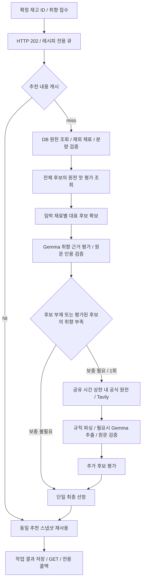

# 냉장고 레시피 추천 설계 v20

정책은 `recipe-rerank-v20`, Worker 계약은 `recipe-grounded-v10`이다. 이번 v20은 FastAPI만 변경하며 기존 Worker v10과 호환된다. 원천별 맛 평가에는 기존 023 SQL이 별도로 필요하다. 기존 레시피 작업 / 결과 저장 테이블은 유지한다.

## 역할과 처리 흐름

원천 자체가 없는 임박 재료는 모델 평가 전에 보충할 수 있다. 이 경우에도 한 작업의 보충 묶음은 한 번뿐이다. 처리 중 후보를 늦게 추가해 완료 결과를 변경하거나 콜백을 두 번 보내지 않는다.

| 모듈 | 책임 |
| --- | --- |
| service | 재고 정규화, 후보 검증, 처리 단계 연결, 응답 조립 |
| candidate_pool | 희귀한 임박 주재료의 대표 후보 보존, 단계별 후보 집계 |
| planning / preferences | 모델 입력 제한, 취향 근거 검증, 원문 판정 재사용 |
| selection | 현재 후보와 검증된 판정에 기반한 단일 최종 선정 |
| replenishment | 공식 원천과 웹 원천의 공유 예산, 저장 승인 관리 |
| web_provider | 웹 검색과 원천 처리 연결 |
| source_parsing | 원문 규칙 파싱 |
| source_processing | 원천별 모델 추출, 검증, 동시 처리 공유와 실패 재시도 유예 |
| result_cache | 요청 멱등키와 분리된 추천 스냅샷 재사용 |
| quantities | 원문 인분 / 분량 기반 재고 ID별 FEFO 가상 배분 |

## 최종 추천 정책

- 최대 10개를 목표로 하되 검증된 후보가 적으면 적게 반환한다. 상품명과 식재료명은 검토 사전 / ingredientKey로 연결한다. 순두부와 두부, 부위와 가공 상태를 임의로 동일시하지 않는다.
- 취향이 있으면 검증된 MATCHED만 정식 추천한다. UNKNOWN은 확인 후보에 최대 3개 분리하고 NOT_MATCHED는 제외한다. 적은 수나 0개도 허용한다. 같은 상태에서는 임박 활용을 우선한다. 취향 일치 + 임박 활용이 최우선이며 취향 일치 비임박 후보도 취향 불일치 임박 후보보다 앞선다.
- 같은 취향 상태와 임박 활용 조건에서 서로 다른 원문 근거 수, 아직 쓰지 않은 임박 주재료 / 전체 임박 재료 활용, 추가 구매 부담과 분량 확인 상태를 비교한다. 같은 인용에 여러 태그가 연결돼도 근거 수를 이중 가산하지 않는다.
- 양념 / 물을 제외한 부족 식재료 5종 이내를 우대한다. 5종 초과 후보도 제거하지 않는다. 추가 구매 2만원은 목표이며 가격 / 포장 단위 데이터가 없어 충족 여부는 미확인이다. 부족 식재료가 있으면 `SHOPPING_COST_UNVERIFIED`와 설명을 제공한다.
- 동일 조건에서는 최근 추천 / 주재료 중복을 고려한다. 취향이 있으면 안정적인 식별자로 동률을 결정하고, 무취향이면 한국 계절 / 식사 시간과 요청 seed로 동등 후보를 다양화한다. 매번 다른 목록을 보장하지 않는다.
- `score`는 기본 재료 적합 점수다. 최종 순위나 AI 신뢰도 / 맛의 정확도와 같지 않다. `reason`, 취향 근거, 임박 활용과 부족 재료를 함께 확인한다.

## 취향 평가와 후보 보존

Gemma는 원문에 근거한 취향 판정을 담당한다. 최종 순서는 FastAPI가 정하며 모델이 재고 수량 / 소비기한 / 가격을 재계산하지 않는다. 입력 후보 ID 순서는 유지하도록 요청하고 원문 인용과 태그별 판정을 검증한다.

`preferenceMatch`는 MATCHED / NOT_MATCHED / UNKNOWN / NOT_REQUESTED다. 태그별 상태는 `preferenceAssessments`의 tag / status / evidence로 제공한다. MATCHED는 하나 이상의 태그가 유효한 원문 근거를 갖는다는 뜻이며 전체 태그 충족이나 알레르기 안전을 보증하지 않는다. 미평가 / 실패 / 거부된 근거는 UNKNOWN이다.

후보가 많은 식재료가 평가 창을 독점하지 않도록 임박 주재료별 대표 후보를 먼저 확보한다. 잔여 슬롯으로 적은 수의 후보를 가진 재료의 평가를 완성한다. 입력은 기본 16,000바이트 / 최대 24,000바이트이며, 초과 시 대표성을 고려한 평가 창만 줄인다. 원문 재료 / 분량 / 조리 단계는 공개 결과에서 보존한다. `AI_INPUT_WINDOW_REDUCED`는 전체 DB에 후보가 없다는 뜻이 아니다.

웹 보충의 취향 부족 판정은 해당 임박 주재료의 적합 DB 후보를 모두 정상 평가했을 때 사용한다. 미평가 후보가 남았다는 이유만으로 해당 취향의 요리가 없다고 단정하지 않는다. `trace.candidateCoverage`는 정규화한 임박 주재료별 eligible / shortlisted / evaluated / recommended 수를 기록한다. 정확도 지표가 아닌 선별 단계 진단이다.

## 원천 보충과 시간 상한

- 한 추천의 원천 보충은 최대 한 번이다. `RECIPE_SUPPLY_TIMEOUT_SECONDS`는 기본 8초, 설정 범위 1~20초다. 공식 원천 / Tavily / 원문 추출이 이 예산을 공유하며 전체 AI 기본 45초 예산의 잔여시간도 넘지 않는다.
- 공식 원천 대기는 최대 3초다. 제외 조건을 통과하고 요청 주재료 / 취향 근거를 충족한 경우에만 보충됐다고 본다. 그렇지 않으면 남은 예산 안에서 Tavily를 검색한다.
- RANK는 최대 두 단계, 각 단계 상한은 기본 20초와 전체 잔여시간 중 작은 값이다. 이는 큐 / DB / 콜백을 포함한 전체 HTTP SLA 보장이 아니다.
- 시간 초과 시 `RECIPE_SUPPLY_BUDGET_EXHAUSTED`, 검증 자료 부족 시 관련 경고를 붙이고 기존 검증 후보를 반환한다. 개수를 채우기 위해 조리법 / 분량을 생성하지 않는다.
- Tavily 승인 도메인은 검색 허용 목록이 아니라 원천 DB 등록 승인 목록이다. 미승인 원천은 본문 검증을 통과해도 원천 DB에 등록하지 않고 `WEB_SOURCE_NOT_REGISTERED`로 구분한다. 작업 스냅샷에 결과 본문은 보관된다. 공개 검색 가능 여부가 저장 / 가공 권한을 뜻하지 않으므로 서비스 원천의 이용 조건 검토는 별도다.
- 규칙 파싱이 실패하면 EXTRACT는 최대 2건을 시도한다. 원문 인용 / 단계 순서 / 필수 분량을 검증하고 혼합 배수 조리는 제외한다.

## 캐시와 일관성

요청 멱등성과 추천 내용 캐시는 다르다. 같은 requestId와 같은 본문은 같은 작업, 다른 본문은 409다. 새 추천 접수에는 새 requestId를 사용한다.

취향이 있으면 새 requestId여도 재고 스냅샷 / 사용자 / 냉장고 / 태그 집합 / 인분 / 제외 조건 / 최근 추천 / 정책 / 모델 / 공급자 설정 / 한국 날짜와 시간대가 같으면 추천을 기본 300초 재사용한다. 태그 배열 순서만 바뀐 경우 태그별 응답은 현재 요청 순서에 맞춘다. 취향이 없으면 요청 seed를 분리해 동등 후보를 다양화한다. 재고나 조건이 달라지면 새로 계산한다.

동일 스냅샷의 동시 계산은 한 번을 공유하며 응답은 깊은 복사로 격리한다. 검증된 AI 추천은 선택적 웹 보충이 실패해도 TTL 동안 유지하지만 모델 실패 / 거부된 근거의 폴백을 정상 취향 결과로 고정하지 않는다. 모든 대기자가 취소되면 진행 중 작업도 취소한다.

`trace.recommendationCacheHit=true`는 완료 스냅샷 재사용 또는 동시 계산 공유다. 재사용 요청의 aiCalls / 검색 수 / 입력 크기 등 실제 작업 카운터는 0이고 timingsMs는 현재 요청의 recommendationMs다. 추천 내용 / recommendationId / generatedAt / candidateCoverage는 원본 스냅샷을 유지한다. `RECOMMENDATION_SNAPSHOT_REUSED`로 구분한다.

레시피별 검증 취향 판정은 별도 메모리 캐시에 최대 512건 / 600초 보관한다. 원문 / revision / 태그 집합 / 모델 / 프롬프트 / 정책을 구분한다. UNKNOWN / 실패 / 거부 판정은 저장하지 않는다. 이 판정을 재사용해도 현재 재고의 사용량과 순위는 다시 계산한다.

원천 처리 키는 URL / 제목 / 원문 지문 / 파서 / 모델 / 프롬프트다. 동일 원천의 추출을 공유하고 최대 64건 보관한다. 성공은 레시피 캐시 TTL, 통신 오류는 15초, 원문 거부 / 빈 본문은 최대 60초 재시도 유예다. 요청 자체의 예산 부족은 원천 실패로 캐싱하지 않는다.

이 캐시는 프로세스 메모리다. 재시작 / replica 사이의 공유 / DB 변경 즉시 무효화는 보장하지 않으며 TTL 뒤 다시 평가한다. 독립 수집 작업이나 영속 취향 프로필까지 구현한 구조는 아니다.

## 분량 / 재고 / 운영 계약

검토된 양념 / 물은 구매 필요 식재료에서 제외하지만 원문 분량을 보존한다. 신선 마늘 / 생강이 주재료면 실제 재고를 확인한다. 제외 재료 조건은 양념에도 우선한다. `PANTRY_UNVERIFIED`는 실제 보유량 검증을 뜻하지 않는다.

레시피별로 소비기한순 FEFO 가상 배분을 계산한다. 원문 인분 / 단위가 없으면 UNRESOLVED이며 임의 개수 / G 환산을 하지 않는다. 각 추천은 독립 선택지이며 백엔드가 선택한 한 요리의 재고 fingerprint를 확인하고 원자적으로 차감한다.

사진 분석 큐 / 콜백은 변경하지 않는다. 레시피 전용 큐 기본 소비자 2개 / 최대 4개, 대기 최대 100건이며 인메모리 단일 프로세스 기준이다. GPU는 사진과 같은 모델 / LLM 세마포어를 사용하므로 완전한 자원 격리가 아니다. 작업 처리 기본 상한은 120초, 큐 대기는 별도다. 정상 종료 시 잔여 작업 저장 / 콜백을 최대 10초 시도하지만 강제 종료 후 큐 재개나 자동 콜백 재전송은 보장하지 않는다.

RANK 연속 일시 장애 3회면 30초 호출을 제한하고 복구 시험 하나를 허용한다. 빠른 연결 / 서버 장애는 같은 시간 예산 안에서 최대 1회 재시도하며 429 / 시간초과는 즉시 재전송하지 않는다. Worker 실패 로그의 reason_code로 잘림 / 스키마 / 원문 인용 / HTTP / 시간초과를 구분하고 원문 / 키를 노출하지 않는다.

[레시피 비동기 연동 명세](recipe_async_api.md)를 따른다. 로컬 회귀 시험은 제어된 모델 응답과 오류 주입 검증이다. 실제 Gemma 품질, 추천 적합성과 처리시간 개선은 FastAPI / Worker 배포 후 별도로 측정한다.

## 사용자와 냉장고 식별

신규 `POST /ai/v1/recipe-recommendations`는 `userId`와 `refrigeratorId`를 함께 받습니다. `userId`는 필수 양의 정수이며 생략 / null / 0 / 음수 / 소수 / 문자열 / boolean은 HTTP 400 INVALID_REQUEST입니다. 백엔드는 로그인 사용자 ID를 확정하고 해당 냉장고의 접근 권한을 검증한 뒤 사용자 취향과 확정 재고를 전달합니다. AI 서버가 userId로 사용자 정보를 조회하거나 소유권을 검증하지는 않습니다. X-Internal-API-Key 인증은 유지합니다.

202 접수 응답은 기존 jobId / requestId / status / submittedAt을 유지합니다. GET 작업 결과와 레시피 콜백의 최상위 userId / refrigeratorId, 완료 result.userId / result.refrigeratorId에는 요청한 두 ID를 반환합니다. 실패 작업에도 최상위 두 ID를 유지하며 result는 null입니다. userId 추가 이전의 완료 / 실패 이력은 알 수 없는 사용자 값을 추측하지 않고 userId=null로 조회합니다. 아래 신규 형식 예시의 userId=101은 설명용 가상 값이며 과거 시험에서 수집한 실제 사용자 ID가 아닙니다.

요청 멱등 해시에 userId를 포함하므로 동일 requestId를 다른 userId로 다시 보내면 409 IDEMPOTENCY_CONFLICT입니다. requestId는 기존처럼 전체 작업 범위에서 유일해야 합니다. 새 사용자 / 새 추천은 새 requestId를 사용합니다. 추천 결과 캐시는 userId와 refrigeratorId 모두로 격리하고 같은 냉장고를 공유하는 다른 사용자의 응답 스냅샷은 재사용하지 않습니다. 공개 원천에 대한 취향 판정 캐시는 같은 원문 / 태그의 검증 결과만 재사용하며 사용자 이력이 아닙니다.

두 ID는 작업의 기존 JSONB snapshot에 저장됩니다. 기존 022 테이블이 있으면 userId 추가 자체에는 새 SQL이 없습니다. 원천 맛 평가 기능은 별도로 023 SQL이 필요합니다. userId는 재고 fingerprint 계산에 포함하지 않으며 기존 재고 SHA-256 알고리즘을 유지합니다. 모델 / 외부 검색에는 userId를 보내지 않습니다. 개인 선호나 선택 이력을 AI DB에서 자동 조회 / 학습하는 기능을 추가한 것은 아니며 취향과 recentRecipeIds는 계속 백엔드가 요청에 전달합니다. 영수증 / 실물 분석 및 냉장고 단위 개인 보정 계약은 바꾸지 않습니다.

## 원천별 맛 특성 평가

레시피 원문 전체를 기존 Gemma의 PROFILE 단계로 사전 평가하고 `recipe_ai.taste_profiles`에 저장합니다. SPICY / SWEET / SALTY / MILD / PEPPERY를 각각 SUPPORTED / NOT_SUPPORTED / UNKNOWN으로 평가합니다. 칼칼함은 일반 매운맛과 분리하며 국물요리로만 제한하지 않습니다. SUPPORTED는 AI 추정과 원문 근거 검증 통과이며 실제 맛 / 맛 강도 / 관능평가 정답을 확정한 값이 아닙니다.

원문 번호와 인용의 조합을 출력 스키마로 제한하고, 공백 차이 외의 다른 내용 / 번호는 거부합니다. 단일 재료명만으로 맛을 확정하지 않으며 조리 구절과 분량 근거를 검증합니다. 튀김 / 강한 양념의 담백함 주장과 근거 부족은 UNKNOWN으로 보류합니다. 원문 한 배치의 분량이 모두 있으면 기준 인분 미상이어도 정성 평가가 가능하지만 인분 / 사용량 환산은 하지 않습니다.

추천 시 전체 검색 후보의 현재 원문 / 모델명 / 프롬프트 / 평가 버전과 일치하는 저장 평가를 조회합니다. 저장 평가는 AI 입력 창 밖 후보에도 적용하고, 준비되지 않은 원천 / 별도 요구는 기존 제한된 요청별 평가와 규칙 결과로 처리합니다. 모든 원천이 사전 평가된 상태라는 뜻은 아닙니다. 저장된 UNKNOWN을 단일 재료명 주장으로 덮지 않습니다.

추천 항목의 `tasteProfile`은 기본 null이며 dimensions 배열로 평가와 evidence(field / referenceNo / quote), limitations를 제공합니다. 기존 preferenceAssessments는 요청 태그별 상태를 유지합니다. trace.tasteProfileCount는 일반 유효 후보 중 평가가 연결된 수이며 모델 호출 수가 아닙니다. TASTE_PROFILE_USED와 구분하고, 프로필만 재사용하면 recommendationEngine=AI / aiCalls=0일 수 있습니다. 사진 분석 / 개인 피드백 / 레시피 원천 동기화 API는 변경하지 않습니다.

FastAPI / Worker를 함께 배포하고 먼저 DB 소유자 권한으로 023_recipe_taste_profiles.sql을 적용해야 합니다. dev receipt_ai 역할은 CREATE 권한이 없어 현재 직접 적용은 거부됐습니다. SQL에 해당 역할의 새 테이블 / 시퀀스 최소 권한을 포함했으며 다른 환경 역할은 운영자가 확인합니다. 조회 오류 / 2초 초과 시 TASTE_PROFILE_STORE_UNAVAILABLE로 기존 추천을 유지합니다.

사전 평가는 배포 환경에서 `python -m app.recipes.profile_backfill --limit 20 --after-id 0`으로 명시한 ACTIVE 승인 원천만 순차 처리합니다. 동일 버전을 재사용하고 처리 중 바뀐 원천 / 미등록 웹 원천은 저장하지 않습니다. 기존 GPU 자원을 공유하므로 작은 묶음으로 비혼잡 시간에 실행합니다. 별도 자동 수집 데몬이나 모든 원천의 평가 완료를 뜻하지 않습니다.

실제 RunPod 원문 시험과 별개로 사람 검토 정답셋은 아직 필요합니다. taste_evaluation 도구는 맛별 precision / recall / coverage / abstained를 구분하며 미확정을 정답으로 계산하지 않습니다. 원문 검토 라벨과 실제 관능평가를 구분합니다.

## v20 추천 적합성과 임박 소모량

- 취향 태그가 있으면 검증된 `MATCHED` 후보만 `recommendations`에 포함한다. 부족 재료가 있더라도 일치 후보는 유지한다. 10개를 맞추기 위해 `UNKNOWN` / `NOT_MATCHED`를 채우지 않는다. 일치 후보가 없으면 정상 완료 결과의 추천 배열이 비어 있을 수 있다.
- `UNKNOWN`은 불일치가 아니다. 기존 재료 종류 확인 후보와 함께 `confirmationCandidates` 최대 3개에 분리하고 `confirmationReasons`에 취향 미확인 사유를 표시한다. 명시적 `NOT_MATCHED`는 두 배열에서 제외한다. 이 배열은 10위 밖 차순위 목록이 아니다.
- 취향이 없으면 기존 재고 / 임박 활용 / 구매 부담 기준의 추천을 유지한다. 취향 미확인을 만드는 장애가 나면 취향 일치로 위장하지 않고 확인 후보와 경고를 반환한다.
- 기존 취향 / 소비기한 우선순위 안에서 제목에 명시된 임박 주재료, 재료 사전상 임박 주재료, 부재료 포함을 구분한다. 사전상 MAIN이라고 무조건 요리의 중심이라 확정하지 않는다.
- 같은 조건이면 기존 `inventoryUsage`의 확정 배분값으로 임박 재고 소모 비율을 비교한다. 임박 재고 ID만 포함하고 여유 재고는 분모에서 제외한다. 같은 재료 / 단위별 사용량을 가용량으로 나눈 후 그룹 평균을 비교한다. g와 개수를 절대량으로 합하지 않는다. 이는 목록 내 여러 레시피를 함께 조리한 배분이나 실제 차감이 아니다.
- 인분 / 분량 / 단위 미확정은 `UNRESOLVED`로 보존하고 소모 비율을 생성하지 않는다. 비교 가능한 분량이 확인된 후보를 우대하지만, 미확정을 실제 0 사용이나 재고 불필요로 해석하지 않는다.
- `reason`에 제목상 주재료 / 역할 규칙 / 부재료 근거와 소모량 확인 상태를 설명한다. 신규 요청 / 응답 필드는 없다.
- `PREFERENCE_MATCH_COUNT_BELOW_LIMIT`: 검증된 취향 일치 수가 요청 상한 미만. `PREFERENCE_UNVERIFIED_CANDIDATES_SEPARATED`: 취향 미확인 확인 후보를 별도로 반환. `CANDIDATE_COUNT_BELOW_REQUEST_LIMIT`는 최종 추천 수에도 적용한다.
- 정상 확인 후보도 기존 오류 캐시 제외 조건을 통과하면 캐시할 수 있다. 실패 / 거부된 근거를 성공으로 바꾸지 않는다.
- 이번 v20 변경은 FastAPI 선정 정책만 변경한다. Worker `recipe-grounded-v10`와 호환되며 새 SQL은 없다. 맛 평가 테이블 023 미적용은 별도 선행 작업으로 남는다.
