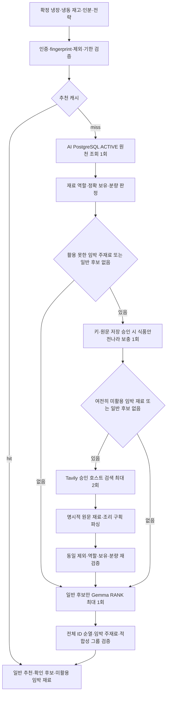

# 냉장고 레시피 추천 — 조리 가능성 분리·임박 주재료·웹 보충 정책 v7

## 목적

추천 개수보다 실제 재고로 만들 만한 요리를 우선한다. 일반 추천과 종류·역할 확인 후보를 분리하며 검증된 결과가 적으면 그만큼만 반환한다. 원문 재료·분량·조리 단계는 변경하지 않고, 모델은 검증된 후보의 순서만 조정한다.

## 처리 흐름

DB 검색·후보 검증은 CPU FastAPI가, RANK는 기존 GPU Worker의 Gemma가 담당한다. 첫 PLAN·SELECT 호출, 임의 URL 실행, LLM 조리법 생성은 하지 않는다.

## 일반 추천과 확인 후보

- recommendations: 정확히 보유한 식품이 연결되고, 명확히 없는 주재료나 역할 미검토 누락·계열 확인이 없는 후보다.
- confirmationCandidates: 같은 계열의 종류·부위 확인 또는 미검토 누락 재료가 남은 후보다. 최대 3개이며 일반 추천과 별도로 표시한다. 필수 재료가 확실히 없는 후보는 여기에도 넣지 않는다.
- 정확한 식품 연결 0개인 후보는 일반 추천에 넣지 않는다. 계열 힌트만 있는 후보는 확인 목록에서만 제공한다.
- UNKNOWN을 양념으로 가정하지 않는다. 스파게티·미역·문어·주꾸미·가지·호박 등 확인된 핵심 식품 이름을 MAIN 규칙에 포함한다. 검토 목록은 모든 식품의 의미를 완벽히 판별하는 분류기가 아니다.
- 일반 추천의 feasibility는 QUANTITY_VERIFIED / NEEDS_CHECK / NEEDS_SHOPPING이다. 확인 후보는 NEEDS_CHECK이며 confirmationReasons에 확인 이유를 제공한다.
- confirmationReasons는 원문 인분 부재·재료 종류·상태·역할 확인을 설명한다. 인분 미상이라고 기본 1인분이나 2인분을 넣지 않는다.
- recommendationEngine=EMPTY는 일반 추천이 없다는 뜻이다. confirmationCandidates가 남아 있을 수 있다.
- 실제 수량·중량 계산은 동일 이름·검토된 별칭과 같은 EA/G/ML끼리만 수행한다. 두부↔순두부·버섯 종류·고기 부위를 대체나 수량 충족으로 확정하지 않는다.
- 물은 기본 가용이지만 양은 미확인이다. 조미료는 pantryIngredientNames에 명시한 검토된 양념만 참고한다. 해당 요리에서 MAIN이 되는 마늘 등을 팬트리로 우회 공급하지 않는다.
- 제외 재료는 부분 문자열·명시 별칭으로 검사한다. 닭고기·소고기 같은 포괄 이름은 검토된 부위에도 적용한다. 특정 버섯만 제외한 것을 모든 버섯 제외로 확대하지 않는다. 이 처리는 알레르기 안전 보증이 아니다.

## 임박 활용과 순위

USE_EXPIRING 전략이 있으면 다음을 코드가 보호한다.

1. 정확히 연결된 임박 MAIN 재료를 쓰는 요리.
2. 임박 SIDE 등만 쓰는 요리.
3. 임박 활용이 없는 요리.

같은 그룹 안에서는 적합성 그룹 → 추가로 확인·구매할 재료 수 → 가장 빠른 기한 → 임박 MAIN 종류 수를 비교한다. 이어 기본 점수·원천 ID로 결정한다. SIMPLE_COOKING만 요청하면 동일 적합성에서 원문 단계 수를 비교한다. 단계 수를 조리시간으로 단정하지 않는다.

usesExpiringIngredients는 모든 정확 매칭 임박 이름, usesExpiringMainIngredients는 그중 현행 MAIN 판정 이름이다. 이름 포함은 실제 소비량 검증과 다르다. 실제 사용량은 ingredientRequirements / inventoryUsage의 계산 결과와 함께 읽는다.

USE_EXPIRING만 요청하면 정확 매칭 임박 재료를 쓰는 후보만 남긴다. 순두부·두부 같은 계열 확인만으로 임박 활용을 달성했다고 표시하지 않는다.

AI는 후보 전체 ID의 순열만 반환한다. 날짜·원문·재료·분량·후보를 추가·제거하지 않는다. 후보가 하나면 호출하지 않고, 잘못된 순열·모델·프로토콜·시간 초과는 기본 추천을 유지한다.

## 임박 재료별 검색 보충

단순히 추천이 limit 미만이라는 이유로 외부 조회하지 않는다. 일반 후보의 임박 MAIN 활용 이름을 집계해 아직 활용되지 않은 임박 재료를 기한 ASC·동일 날짜 재고 ID ASC로 찾는다. 대파를 쓰는 요리가 있다는 이유로 두부·버섯 보충을 생략하지 않는다.

- 식품안전나라: 기존 키와 원문 저장 승인이 있을 때 한 번 보충한다. 사용 가능한 원천을 저장·재검증한다.
- Tavily: 구조화 원천 보충 뒤에도 미활용 임박 재료가 남거나 일반 후보가 없을 때 마지막으로 실행한다. 초점 재료 최대 2개에 대해 검색당 결과 최대 5개다.
- Tavily 검색어는 재료명과 조리법 검색 문구뿐이다. 사용자·냉장고 ID, 이미지 URL, 보유량은 전달하지 않는다.
- TAVILY_API_KEY와 RECIPE_TAVILY_APPROVED_DOMAINS가 모두 필요하다. 후자는 본문 저장·가공·서비스 제공 조건을 확인한 정확한 호스트의 JSON 배열이며 기본값은 []이다. 하위 도메인·와일드카드를 자동 승인하지 않는다.
- 검색 API의 include_domains와 include_raw_content를 사용한다. 응답 URL의 호스트도 다시 확인한다. 앱이 검색 URL을 직접 요청하거나 리다이렉트를 따라가지 않는다.
- 본문의 단일 schema.org Recipe 또는 명시적인 Markdown 재료·조리 구획만 파싱한다. 요약·불완전 분량·모호한 구획·여러 요리가 섞인 자료는 Recipe로 승격하지 않는다.
- 원문 인분은 '2인분', '2 servings'처럼 명시된 경우만 사용한다. recipeYield=12를 12인분으로 추정하지 않는다.
- 승인 원천만 TAVILY_WEB과 sourceUrl로 저장한다. sourceRecipeId는 URL의 SHA-256, revision은 본문의 SHA-256이다. 제목만으로 원천 간 중복을 제거하지 않는다.
- 파싱 성공은 식품 안전·맛·모든 문장의 정확성 검수 완료를 뜻하지 않는다. 일반/확인 후보 판정을 다시 수행한다.
- 공급자 미설정·장애·후보 미확보 시 기존 일반 추천과 확인 후보를 유지하며 경고한다. 정상 DB에 후보가 없다는 이유만으로 503을 반환하지 않는다. DB 자체 의존성 오류는 503이다.
- 웹 원문 저장 승인 호스트가 없으면 Tavily 키만 넣어도 자동 수집하지 않는다. 검색 API 이용 권한이 대상 콘텐츠 재배포 권한을 대신하지 않는다.

## AI 입력과 시간·캐시

- 정책 recipe-rerank-v7, 프롬프트 recipe-grounded-v3. FastAPI와 Worker를 함께 배포한다.
- 일반 후보 기본 상한은 12개다. 공개 응답의 ingredients / steps / amountText는 전체 원문을 유지한다.
- RANK JSON 입력 예산은 24,000바이트다. 초과하면 재료를 번호 기반 배열로 표현하고 ingredientColumns로 열 뜻을 전달한다. 보유·부족·임박 목록도 같은 원문 번호를 참조한다. 후보와 원문 재료 개수는 줄이지 않는다.
- 압축 입력은 원문 조리 첫 2단계·각 100자와 단계 수를 보존하고 detailsReduced / stepsMayBeTruncated로 생략 여부를 알린다. 여전히 초과하면 기본 추천으로 돌아간다.
- 외부 보충 공유 예산은 min(20초, RECIPE_AI_TIMEOUT_SECONDS / 2)이며 식품안전나라 한 번의 대기는 최대 10초다. 남은 예산을 Tavily에 전달한다. RANK는 생성 시작 후 경과 시간을 뺀 남은 AI 예산으로 실행한다.
- 기본 AI 예산은 45초다. DB 드라이버·동기 파싱·취소 지연까지 포함한 엄격한 HTTP SLA나 GPU 커널 즉시 중단 보장은 아니다.
- AI 실패·외부 장애 결과는 캐싱하지 않는다. 의도적 AI 비활성·단일 후보 결과는 캐싱할 수 있다.
- 캐시에는 정책·모델·프롬프트·재고·냉장고·제외·전략·인분·limit·양념·공급자 활성/승인 설정·승인 호스트·서울 날짜를 포함한다.
- trace의 호출 수는 캐시 원본을 생성할 때의 값이다. 캐시 재조회가 새 AI·검색 호출을 했다는 뜻은 아니다.
- trace.searchCount는 DB 조회 0~1, externalSearchCount는 식품안전나라 호출 시도 0~1, webSearchCount는 Tavily 검색 시도 0~2다. candidateCount는 역할 필터 전의 중복 제거 후보 수다.

## API 추가 필드와 기존 계약

POST /ai/v1/recipe-recommendations의 인증은 X-Internal-API-Key를 유지한다. 요청 필드는 바꾸지 않는다.

| 위치 | 필드 | 의미 |
| --- | --- | --- |
| 응답 | confirmationCandidates | 최대 3개의 종류·역할 확인 후보. 일반 추천과 별도 표시 |
| 응답 | uncoveredExpiringIngredients | 일반 추천의 MAIN으로 아직 활용하지 못한 임박 이름 |
| 레시피 원천·추천 | sourceUrl | 웹 원문 URL. 기존 원천은 null 가능 |
| 추천·확인 후보 | confirmationReasons | 종류·상태·역할·인분 확인 이유 |
| 추천·확인 후보 | usesExpiringMainIngredients | 정확 매칭 임박 MAIN 이름 |
| trace | externalSearchCount / webSearchCount | 원본 생성 시 공급자 호출 시도 수 |

mealPlan은 빈 focusIngredientIds/ideas를 유지한다. score는 규칙 후보 점수이며 AI 신뢰도나 최종 순위 점수가 아니다. 확인 후보를 일반 추천으로 합치거나 '바로 조리 가능'으로 표시하지 않는다.

새 SQL은 없다. 원천 확장 필드는 기존 JSONB snapshot/raw_source에 들어간다. 백엔드 동기화에서도 sourceUrl 추가 필드 처리를 확인해야 한다. 실제 재고 수정·차감·사용자 선택 피드백·모델 가중치 학습·전역 피드백 승격은 수행하지 않는다.

## 경고

기존 경고에 다음이 추가된다.

- CONFIRMATION_CANDIDATES_SEPARATED: 확인 후보를 별도 목록으로 분리.
- UNCOVERED_EXPIRING_INGREDIENTS: 일반 추천으로 활용되지 않은 임박 재료가 남음.
- WEB_SEARCH_NOT_CONFIGURED_OR_APPROVED: Tavily 키 또는 승인 호스트 목록 미설정.
- WEB_SEARCH_UNAVAILABLE: 웹 검색 오류·시간 예산 소진, 기존 결과 유지·미캐싱.
- WEB_SEARCH_NO_VERIFIED_RECIPE: 검색했으나 원문 검증을 통과한 레시피가 없음.

AI_UNAVAILABLE_OR_INVALID, AI_ORDER_CONSTRAINED_BY_ELIGIBILITY, RULE_RESULTS_NOT_AI_JUDGEMENT, MISSING_MAIN_INGREDIENT_RECIPES_EXCLUDED, UNREVIEWED_MISSING_INGREDIENTS_NEED_CHECK 등의 기존 경고도 유지한다.

## 검증 범위

성공 응답률과 추천 의미 품질을 구분한다. 정확한 식품 연결 0개인 일반 추천 수, 미보유 핵심 식품 통과 수, 임박 MAIN 활용, 추가 구매 부담, 확인 후보 수, 원문 보존, AI 실제 호출·입력 예산을 각각 검증한다.

HTTP 모형 시험은 Tavily 요청 형식·승인 호스트·본문 파싱·실패 보존 검증이지 실제 검색 품질 실측이 아니다. 승인 원천 재생도 실제 dev/GPU 시험과 구분한다. 사용자 선택·실제 조리·건너뛴 이유의 학습 연동은 피드백 계약과 평가 데이터를 정한 후의 별도 범위다.

공식 API 참고: [Tavily Search](https://docs.tavily.com/documentation/api-reference/endpoint/search). 구조화 원천과 일반 검색 결과의 콘텐츠 조건은 각각 확인한다.
