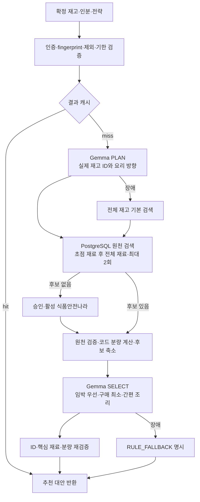

# AI 기반 냉장고 재고 활용 추천 — 정책 v3

## 목적과 흐름

AI가 냉장·냉동 재고를 보고 먼저 사용할 재료와 식사 방향을 계획하고 실제 원천 후보를 비교한다. 모델이 원천 레시피나 사용자 재고를 생성·수정하지 않는다.

TheMealDB·Tavily 자동 조회는 현재 요청 경로에 연결하지 않는다. 공급자는 키와 원문 저장 승인이 모두 있어야 동작한다. 후보가 없고 공급자가 미설정이면 기존 503 의존성 오류 계약을 유지한다.

## AI와 코드의 역할

- PLAN 입력: 유효 재고의 ID·이름·수량/중량·보관·소비기한, 오늘(KST), 요청 인분·제외·전략. 출력: 실제 ingredientId 최대 12개와 요리 방향 최대 3개. 방향은 확정 조리법이 아니다.
- 검색: 초점 재료 질의 후 전체 재고로 한 번 넓혀 최대 2회. AI가 SQL·URL·키·임의 도구를 실행하지 않는다.
- SELECT 입력: 검색 후보 상한(기본 12개)까지 전달한다. 재료별 분량 판정을 한 번만 넣고, 보유·부족·임박·제목 명시 누락 재료를 전달한다. 조리문은 첫 2단계·단계당 100자로 제한하고 잘림을 표시한다. 전체 선택 문맥이 24,000바이트를 넘으면 먼저 조리문과 세부 수치를 생략해 후보 수를 유지한다. 그래도 넘으면 후순위 후보부터 줄이며, 1개만으로도 초과하면 폴백한다. 생략된 수치를 추정하지 않고 조리문 없는 후보를 간편 조리로 선택하지 않는다. 최종 응답 원문은 자르지 않는다.
- SELECT 출력: candidateId, strategy, essentialIngredientNos, reason. Worker는 후보별 유효 재료 번호를 JSON Schema로 제한하고 출력 개수를 요청 limit에 맞춘다. 없는 ID·전략·재료 번호와 같은 전략·후보 중복은 거부하며 같은 핵심 재료 번호의 반복은 중복 제거한다.
- 코드: 임박은 KST 오늘부터 3일 이내로 계산해 모델에 전달한다. 실제 임박 재료가 없는 USE_EXPIRING 선택은 제외한다. 제외·기한·참조 ID·필요량·부족량·잔량을 검증하고 방향별 교차 배치하여 총 limit 이하 반환한다. 표시 reason은 AI 자유 문장을 그대로 노출하지 않고 보유·부족·임박 재료와 원문 단계 수 등 검증된 사실로 구성한다. AI의 후보·핵심 재료 선택 자체의 의미 품질은 별도로 평가해야 한다.
- 원본 ingredients/steps/baseServings/sourceRevision은 변경하지 않는다. 조리 시간·중량·대체 재료를 모델이 생성하거나 자동 적용하지 않는다.

Ollama의 [공식 JSON Schema 출력 방식](https://docs.ollama.com/capabilities/structured-outputs)을 사용하고 스키마로 다시 검증한다. 기존 RunPod Gemma를 재사용하며 신규 모델·GPU는 추가하지 않는다.

| strategy | 의도 | 보증하지 않는 것 |
| --- | --- | --- |
| USE_EXPIRING | 오늘부터 3일 이내 재료 활용 | 기한 경과 재료의 섭취 안전 |
| MINIMIZE_SHOPPING | 핵심 재료·분량 부족 최소 | 명시되지 않은 양념 보유 |
| SIMPLE_COOKING | 원문 단계·수고가 적은 조리 | 원문에 없는 조리시간·해동시간 |

기본 목표는 서로 다른 레시피 10개다. 같은 원천·원천 레시피 ID는 전략이 달라도 한 번만 반환한다. 방향 순서대로 교차 배치하며 방향 내부에서는 제목 명시 누락 재료·없는 핵심 재료·확정 부족 후보를 뒤로 보낸다. 개수를 채우려고 부적합 후보나 규칙 결과를 AI 결과에 섞지 않으며 0~9개도 정상 결과다.

후보 축소 전 규칙 점수의 부족 재료 감점에는 제목에 명시됐지만 없는 원문 재료의 비율을 추가 반영한다. 예를 들어 닭고기가 없는 닭고기 요리를 우선 노출하지 않도록 한다. 제목의 2글자 이상 재료명·검토된 별칭에 한정하며, '무'→'무침' 같은 한 글자 오탐은 피한다. 모든 주재료를 완전히 식별하거나 식품 대체 가능성을 판단하는 기능은 아니다.

## 필요량·가상 잔량

`requiredAmount = 원본 amountValue × targetServings / 원본 baseServings`

- 같은 이름·검토된 별칭과 같은 EA/G/ML끼리만 비교. 1모→g, 큰술→ml, g→ml 추측 금지.
- 인분·수치가 없으면 UNKNOWN_AMOUNT/null. 원문 분량을 1인분으로 가정하지 않는다.
- 같은 재료의 원문 중복 행도 각각 계산하고 재고 ID별 이중 사용을 방지한다. 소비기한이 가까운 ID부터 배분한다.
- ingredientRequirements: 원문 amountText와 필요·배분·부족량. inventoryUsage: 재고 ID별 available/used/remaining.
- 각 추천을 단독 선택한 독립 대안별 계산이며 실제 재고 차감이나 여러 요리 동시 조리 계획이 아니다.
- quantityStatus=SUFFICIENT/SHORTAGE/NEEDS_CHECK. feasibility=NEEDS_SHOPPING/NEEDS_CHECK/QUANTITY_VERIFIED. 보유하지 않은 원문 재료가 하나라도 있으면 NEEDS_SHOPPING이며, 마지막도 수치상 충족일 뿐 해동·기구·식품 안전 보증이 아니다.
- 조미료·물은 냉장고 재고와 분리한다. pantryIngredientNames로 명시한 보유만 참고하며 분량은 PANTRY_UNVERIFIED로 남긴다. 원본 양념 분량·조리문은 삭제하지 않는다.

## API와 운영 계약

`POST /ai/v1/recipe-recommendations`의 인증·기존 필드를 유지하고 추가한다.

- 요청: limit(기본 10, 범위 1~20), targetServings(기본 2), strategies(기본 세 방향), pantryIngredientNames(기본 []). 호출자가 limit=5를 명시하면 5개 이하로 반환한다.
- 응답: recommendationEngine, mealPlan, warnings, trace.
- 항목: strategy, targetServings, quantityStatus, ingredientRequirements, inventoryUsage, essentialIngredientNos, missingEssentialIngredientNos, feasibility, preparationNote.
- score/scoreBreakdown은 후보 축소용 규칙 점수이며 AI 신뢰도·최종 순위 점수가 아니다.
- 정확한 enum·null·오류·JSON 예시는 위키 **AI‐1단계‐API-명세 / 7절**과 코드 RecommendationRequest/RecommendationResponse를 따른다.

RECIPE_AI_ENABLED=true, RECIPE_AI_TIMEOUT_SECONDS=45초, RECIPE_AI_MAX_CANDIDATES=12가 기본이다. 기본 10개 추천에 필요한 후보 공간을 확보하되 입력 바이트 예산으로 실제 후보 수가 줄어들 수 있다. 설정 상한보다 큰 limit도 개수를 보장하지 않는다. 기존 Worker 주소 탐색·REMOTE_INFERENCE_API_KEY로 `POST /internal/v1/recipes/reason`을 X-Worker-API-Key 인증 호출한다.

PLAN·SELECT 최대 2회, 자동 모델 재시도 없음. AI 슬롯은 FastAPI에서 2개, Worker에서는 사진 분석과 같은 inference/LLM 세마포어를 공유한다. 따라서 경합이 있으며 사진 지연이 없다고 보장하지 않는다. 합산 AI 예산은 슬롯 대기 포함이지만 DB·외부 원천까지 포함한 전체 API SLA는 아니다. SELECT에는 남은 예산을 전달하고 Worker도 슬롯 대기부터 제한한다. PLAN의 Worker 기본 예산은 45초다. Worker 시간 초과는 HTTP 클라이언트 작업을 취소하지만 Ollama/GPU 커널까지 즉시 중단된다는 보장은 없다.

- AI: 계획·선택 검증 완료. 적합 후보 0개는 NO_SUITABLE_AI_CANDIDATES 경고와 빈 배열.
- PARTIAL_STRATEGY_COVERAGE: 요청한 전략 일부가 최종 선택에 없음을 알린다. 없는 전략을 규칙 결과로 채우고 AI 판단인 것처럼 표시하지 않는다.
- CANDIDATE_COUNT_BELOW_REQUEST_LIMIT: 선택 전 검색 후보 수 또는 설정 상한이 요청 개수보다 적다.
- CANDIDATES_TRUNCATED_TO_BUDGET: 세부 정보를 압축해도 입력 예산을 넘어서 실제 전달 후보 수를 줄였다. AI가 부적합하다고 제외한 경우와 구분한다.
- RULE_FALLBACK: 비활성/미가동/404/시간 초과/잘못된 출력. 기본 검색임을 고정 경고로 표시한다. strategy=null·핵심 판정 없음·feasibility=NEEDS_CHECK.
- EMPTY: 유효 재고 또는 후보 없음. 유효 재고 0개면 모델·DB·외부 호출 없음.
- AI 실패 폴백은 캐싱하지 않는다. 명시적 AI 비활성 결과는 캐싱 가능.
- 캐시 키: 냉장고·재고 fingerprint·제외·모드·limit·인분·전략 순서·양념·정책·프롬프트·모델·후보 상한·서울 날짜. 기본 TTL 300초.
- 추가 로그에는 engine, 오류 단계·클래스·허용된 원인 코드, AI 시도 수, DB 검색 수, 후보/반환 수를 남긴다. Worker에는 단계별 슬롯 대기·입력 바이트·토큰 수·프리필·생성·로딩 시간이 기록된다. 재고·프롬프트 원문이나 인증키는 이 진단 로그에 기록하지 않는다. trace.aiCalls는 시도한 AI 단계 수다.
- Worker의 기존 토큰·LLM 시간 지표에 레시피 호출도 합산한다. 집계만으로 사진/레시피 토큰이 따로 분리되지는 않는다.
- 원천 동기화는 기존 계약 그대로다. AI 추천·가상 사용량·이유를 원천 변경이나 사용자 재고로 저장하지 않는다. 새 SQL은 없다.

## 평가·후속 범위

기존 16조합 dev 시험은 규칙 검색 기준선이며 새 AI 성능 수치가 아니다. 단위 시험은 ID·단위·중복 배분·캐시·폴백 검증이지 모델 품질 실측이 아니다. RunPod 배포 후 같은 재고에서 핵심 재료 누락·임박 활용·수량 충족·원문 보존·시간·토큰·사진 경합을 비교한다.

선택/조리 완료/건너뛴 이유를 이용한 추천 개인화는 별도 API·동의·저장 정책으로 확정할 후속 범위다. 현재 영수증 피드백과 섞지 않고 클릭을 소비 완료로 보지 않는다. 이번 변경은 추천 피드백 API·추천 이력 SQL·자동 재고 차감·모델 가중치 학습을 추가하지 않는다.
