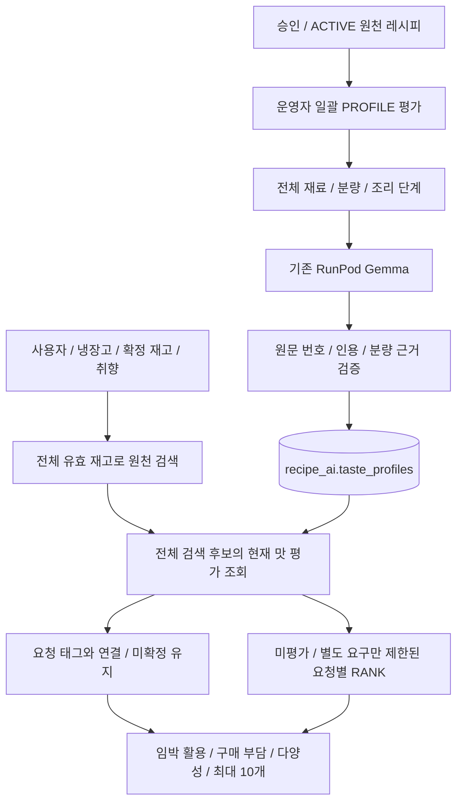

# 레시피 원문 기반 맛 특성

정책 `recipe-rerank-v19`, Worker 계약 `recipe-grounded-v10`, 원천 평가 `recipe-taste-v1`이다. 기존 Gemma를 사용하며 모델 교체 / 가중치 학습은 하지 않는다. 사진 분석과 개인 피드백 보정은 변경하지 않는다.

## 구조와 적용 범위



사전 평가는 사용자 / 재고와 독립적이다. 동일 원천을 사용자마다 반복 평가하지 않는다. 저장 평가는 현재 모델명 / 프롬프트 / 평가 버전 / source / sourceRecipeId / sourceRevision / 제목 / 인분 / 전체 재료 / 단계 지문으로 연결한다. 동일 태그 이름으로 모델 가중치를 교체할 때에는 평가 버전을 명시적으로 올려야 하며 가중치 파일 변경을 자동 감지하는 구조는 아니다.

추천은 전체 검색 후보의 평가를 한 번에 읽는다. 모델 입력 창 밖 후보도 저장 평가가 있으면 취향 판단에 사용한다. 원문 / 버전이 바뀌면 이전 평가를 재사용하지 않는다. 저장 평가가 없다고 레시피를 삭제하지 않으며 기존 제한된 요청별 RANK / 규칙 결과로 처리한다. 모든 후보의 맛 특성이 준비된 상태라는 뜻은 아니다.

## 평가 계약

`PROFILE`은 recipe와 evidenceOptions를 받는다. recipe에는 원문 전체 재료 / 분량 / 인분 / 조리 단계를 담으며 없는 값은 보완하지 않는다. evidenceOptions는 원문에서 만든 TITLE / INGREDIENT / STEP 인용과 원본 번호의 조합이다. 출력 스키마에서 세 값을 묶어 선택하므로 다른 재료 번호에 임의 인용을 연결하지 못하게 한다. 과도하게 긴 원문은 자르지 않고 24KB 입력 상한 초과로 별도 처리한다.

다섯 차원을 각각 한 번 평가한다.

| kind | 의미 |
| --- | --- |
| SPICY | 고추의 매운맛 |
| SWEET | 완성 요리의 단맛 |
| SALTY | 완성 요리의 짭짤한 맛 |
| MILD | 양념과 기름이 과하지 않은 담백함. 약불 / 부드러운 식감과 다름 |
| PEPPERY | 칼칼함. 일반 매운맛과 별도이며 국물요리에만 한정하지 않음 |

| status | 의미 |
| --- | --- |
| SUPPORTED | 모델의 맛 추정과 원문 근거 검증을 통과. 실제 맛 / 강도 / 관능평가 정답을 확정한 값이 아님 |
| NOT_SUPPORTED | 충분한 원문을 검토했으나 해당 취향 특성이 뒷받침되지 않음. 해당 맛이 전혀 없다는 보장은 아님 |
| UNKNOWN | 근거 / 분량 / 원문이 부족하거나 검증 단계에서 판단을 보류함 |

각 차원의 evidence는 field / referenceNo / quote, limitations는 모델의 한계 설명과 서버 검증 코드를 담는다. 제목 referenceNo는 0, 재료는 ingredientNo, 조리는 stepNo다. 인용은 최대 240자다. 공백 / 줄바꿈 차이는 허용하지만 다른 단어나 번호는 허용하지 않는다. 단맛과 짠맛은 동시에 SUPPORTED일 수 있다. 맛 강도 / 확률 / 스코빌 / 나트륨을 생성하지 않는다.

단일 재료만으로는 지원 판정을 통과시키지 않는다. 조리 단계와 계량 근거 또는 명시적인 맛 표현을 함께 요구한다. 단맛 / 짠맛 / 담백함은 명시적인 원문 맛 표현이 없는 경우 전체 재료의 수치 분량 확인도 요구한다. 튀김이나 강한 고추 양념이 있는 요리의 담백함 주장은 보류한다. 반례를 거르는 신호는 맛을 확정하는 규칙이나 검증된 맛의 수치 임계값이 아니다.

기준 인분이 없어도 원문 한 배치의 분량이 모두 확인되면 정성적 맛 특성을 평가할 수 있다. `BASE_SERVINGS_UNAVAILABLE_NO_PORTION_SCALING`을 표시하고 인분 / 재고 소모량을 임의 생성하지 않는다. 요청 인분으로의 사용량 환산은 기존 분량 정책을 유지한다.

## 추천 응답과 태그 연결

요청 필드와 POST / GET / 콜백 경로, userId / refrigeratorId 정책은 유지한다. 각 recommendations / confirmationCandidates에 선택 필드 `tasteProfile`을 추가한다. 기본 null이며 기존 저장 이력도 null로 조회할 수 있다. 프로필이 있으면 dimensions 배열로 위 평가를 제공한다. 이는 해당 레시피의 AI 추정 특성이며 사용자의 취향 프로필이 아니다.

- 매운거 / 매운맛 / 매운음식 / 매콤한거 → SPICY
- 단거 / 단맛 / 달콤한거 / 달달한거 → SWEET
- 짠거 / 짠맛 / 짭짤한거 / 짭짤한맛 → SALTY
- 담백한거 / 담백한맛 / 담백한음식 → MILD
- 칼칼한거 / 칼칼한맛 → PEPPERY

이외 태그는 기존 요청별 평가 대상이다. 안매운거를 MILD로 묶거나 SPICY의 NOT_SUPPORTED만으로 안전한 비매운 음식으로 확정하지 않는다. 제외 재료 / 알레르기 조건은 별도다.

태그별 SUPPORTED → MATCHED, NOT_SUPPORTED → NOT_MATCHED, UNKNOWN → UNKNOWN으로 연결한다. 저장 평가의 UNKNOWN을 단일 재료명 주장이나 오래된 요청 캐시로 덮지 않는다. 기존 preferenceMatch는 태그 하나 이상 MATCHED인 요약이며 모든 태그 충족을 뜻하지 않는다. 기존 원문 / 분량 / 재고 ID 배분은 유지한다.

`trace.tasteProfileCount`는 일반 유효 후보 중 현재 저장 평가가 연결된 수다. 추천된 수나 실제 모델 호출 수와 다르다. `TASTE_PROFILE_USED`로 구분한다. 프로필만 재사용하면 recommendationEngine=AI, aiCalls=0일 수 있으며 model / promptVersion에는 평가 버전을 표시한다. 완료 추천 캐시 적중 시 이 수는 원본 스냅샷의 진단값이다.

## DB와 배포

먼저 `database/migrations/023_recipe_taste_profiles.sql`을 DB 소유자 권한으로 적용하고 FastAPI / Worker를 함께 배포한다. dev 앱 역할 receipt_ai는 CREATE 권한이 없어 해당 앱 계정으로 마이그레이션을 실행할 수 없다. SQL은 확인된 dev 역할에 새 테이블 SELECT / INSERT / UPDATE와 시퀀스 권한을 부여한다. 다른 환경의 앱 역할이 다르면 운영자가 해당 역할의 최소 권한도 맞춘다. 기존 원천 / 백엔드 MySQL / 사진 분석 테이블은 변경하지 않는다.

RECIPE_TASTE_PROFILES_ENABLED 기본 true다. 원천 평가 저장소가 없거나 조회 오류 / 2초 조회 상한을 넘으면 TASTE_PROFILE_STORE_UNAVAILABLE를 표시하고 기존 추천을 유지한다. 문제가 있는 저장 평가 한 건은 건너뛰고 원문 / 비밀키 없는 경고를 남긴다. 설정을 false로 두면 저장 평가 조회를 생략할 수 있다.

## 사전 평가 실행

배포된 FastAPI 컨테이너 / 환경에서 실행한다. 로컬 GPU나 별도 모델을 사용하지 않고 설정된 원격 Worker를 호출한다.

```sh
python -m app.recipes.profile_backfill --limit 20 --after-id 0
```

승인되어 원천 DB에 등록된 ACTIVE 레시피만 원천 ID 순서로 순차 처리한다. 같은 버전의 검증 결과는 재사용한다. 원천을 조회 / 잠근 뒤 지문을 확인하므로 처리 중 원문이 바뀌거나 미등록 웹 원천이면 저장하지 않는다. 실패가 있으면 종료 코드 1이며, 같은 페이지를 다시 실행해 정상 건은 재사용하고 실패 건을 재처리한다. 실패를 해결하기 전에 nextAfterId로만 넘어가면 실패 원천을 건너뛸 수 있다.

사전 평가도 기존 GPU와 LLM 세마포어를 사용한다. 추천 경로에서 전체 재평가를 제거하는 효과가 있지만 일괄 실행 중에는 사진 추론과 자원을 공유하므로 비혼잡 시간에 작은 묶음부터 실행한다. 별도 수집 데몬 / 자동 크론 / 모든 원천의 자동 평가 완료까지 구성한 것은 아니다.

## 품질 검증

실제 RunPod Gemma에서 원문 7개를 최종 재시험했다. 7개 모두 원문 번호 / 인용 검증을 통과했고, 서버 검증 후 35개 맛 차원 중 SUPPORTED 7개 / NOT_SUPPORTED 3개 / UNKNOWN 25개였다. 사전 평가 평균 12.07초, 최소 7.51초, 최대 16.752초였다. 이 시간은 직접 PROFILE 평가의 비용이며 추천 API 전체 처리시간이 아니다. 모델은 매운 순두부찌개 등을 담백하다고 주장하는 반례가 남아 있어 충분한 맛 정확도를 입증하지 못했다. 강한 양념 / 튀김과 충돌하는 담백함, 계량 근거 부족, 맛을 낼 재료가 있는 미지원 주장은 UNKNOWN으로 낮춘다. dev 023은 앱 계정 CREATE 권한 부족으로 미적용이며 실제 DB 저장 / 재조회 검증은 완료하지 않았다.

50~100개 이상의 사람 검토 라벨은 아직 없다. 임의 정답 / 정확도를 생성하지 않으며, 원문 검토 라벨과 관능평가 정답도 구분한다. 준비된 평가 도구는 맛별 precision / recall / coverage / abstained를 구분하고, UNKNOWN을 정답으로 올려 계산하지 않는다.

```sh
python -m app.recipes.taste_evaluation --predictions predictions.json --labels labels.json
```

predictions는 `{profileKey, profile}` 객체의 배열, labels는 `{profileKey, reviewer, dimensions}` 객체의 배열이다. dimensions는 다섯 kind와 검토 상태를 모두 명시한다. 같은 원문 지문 키를 사용해야 하며 중복 라벨 / 검토자 없는 라벨은 거부한다. 레퍼런스가 UNKNOWN인 차원은 정답 계산에서 제외하고, 예측 UNKNOWN은 평가 가능한 정답의 기권으로 집계한다. 자료가 없는 지표는 0이 아닌 null이다.

각 맛 차원의 `cookingEvidence`에는 실제 조리 단계의 번호와 인용을 보존한다. 이 필드는 UNKNOWN에서도 검토한 구절을 나타내며, 맛이 확인됐다는 의미는 아니다.
