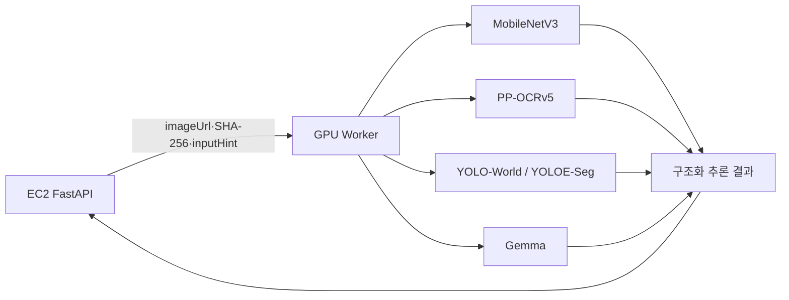

# 다먹자 GPU 추론 Worker

이 폴더는 다먹자 이미지 분석 시스템의 **추론 영역(data plane)** 이다. GPU가 필요한 입력 유형 분류,
문자 인식, 상품 영역 검출과 멀티모달 모델 추론을 수행하고 구조화된 원시 결과를 FastAPI 서버에
반환한다.

레시피에서는 기존 Gemma로 후보 순위 RANK와 웹 본문 구조화 EXTRACT를 수행한다. `POST /internal/v1/recipes/reason`에서 기존 `X-Worker-API-Key`로 인증한다. RANK는 FastAPI가 준 후보 ID 전체를 정확히 한 번씩 반환한다. EXTRACT는 FastAPI가 Tavily에서 확보한 본문을 받아 재료명/분량 구절과 조리문을 원문 인용으로 반환한다. DB 검색/분량 계산/재고 차감 권한은 없다. `gpu_worker/recipe_reasoner.py`가 JSON Schema와 근거를 검증하고 `recipe_contract.py`가 공통 계약을 정의한다. PLAN/SELECT는 호환 경로이며 현 추천 서비스는 호출하지 않는다. 사진과 같은 inference/LLM 세마포어를 공유하므로 자원 경합이 발생할 수 있다.

RANK는 후보 개수와 같은 길이의 candidateIds 순열, preferenceMatchedCandidateIds와 적합 ID별 원문 인용 preferenceEvidence를 출력한다. 취향 태그가 있으면 제공된 원문에서 적합 근거가 있는 후보 ID만 표시한다. 취향이 없으면 서버가 전달한 계절/식사 시간대와 variationSeed를 참고한다. 후보 삭제, 요리 생성, 분량 추론은 하지 않으며 실패 시 FastAPI가 기본 추천과 취향 미확인 상태를 유지한다. FastAPI가 실행 예산을 전달하면 슬롯 대기부터 해당 예산으로 제한하며, 대기/토큰/생성/로딩 시간을 로그로 구분한다.

FastAPI 정책 v16는 임박 주재료 활용 그룹 안에서 검증된 취향 일치를 먼저 비교하고 적합성, 분산 활용과 추가 구매 부담을 뒤에 고려한다. 같은 계열 재고를 정확한 대체/사용/분량 충족으로 취급하지 않는다. 큰 입력은 재료 번호/열 설명 배열로 압축하고 평가 창만 조절하며 공개 응답의 원문은 유지한다. Worker 계약은 recipe-grounded-v7이며 FastAPI와 함께 배포한다. 레시피 큐, 콜백, 원문 검색, ID별 분량 배분은 FastAPI가 담당한다. Worker는 웹 검색/DB 저장을 하지 않는다.

Worker는 재고 서비스의 업무 규칙을 소유하지 않는다. PostgreSQL을 조회하거나 소비기한을 확정하지
않고, 분석 큐와 백엔드 콜백도 관리하지 않는다. 이 경계를 지켜야 모델 구성이나 GPU 제공자를 바꿔도
EC2 FastAPI와 백엔드 계약을 그대로 유지할 수 있다.

## 시스템에서의 위치



FastAPI는 Worker에 이미지 파일 자체가 아니라 접근 가능한 URL과 SHA-256을 전달한다. Worker는
허용된 호스트인지 검사한 뒤 이미지를 직접 내려받고, 해시·형식·크기·픽셀 수를 검증한 경우에만
추론을 시작한다.

## Worker가 반환하는 것

Worker 응답은 백엔드 재고 데이터가 아니라 FastAPI가 후처리할 추론 자료다.

- 입력 유형 예측과 신뢰도: `RECEIPT`, `PRODUCT`, `OTHER`
- OCR 문자열, 줄 번호, 신뢰도와 좌표
- 식품 또는 상품 후보, 카테고리 후보와 모델 신뢰도
- 문서 품질과 진단 정보
- 다운로드·입력 분류·OCR·검출·LLM 단계별 처리 시간
- 사용한 파이프라인과 모델 버전

수량 정규화, 상품 카탈로그 확정, 소비기한 계산, `AI_ESTIMATED`/`NEEDS_REVIEW` 같은 최종 정책은
FastAPI가 담당한다.

## 입력 유형별 추론

### 공통 입력 판별

`inputHint`가 명시되면 그 값을 우선한다. `AUTO`이면 MobileNetV3-Small이 영수증, 실물 상품,
기타 이미지를 분류한다. 신뢰도나 상위 점수 차이가 기준에 못 미치면 FastAPI가 OCR 기반 규칙으로
다시 판단할 수 있도록 원시 결과를 함께 반환한다.

### 영수증

1. PP-OCRv5가 텍스트와 좌표를 추출한다.
2. 긴 영수증은 겹치는 세로 타일로 추가 인식해 작은 상품행 누락을 보완한다.
3. 좌표 기반 규칙으로 상품 가능성이 있는 행만 추린다.
4. 규칙과 카탈로그에서 해결되지 않을 후보만 Gemma에 전달한다.
5. OCR 결과와 모델 후보를 FastAPI에 반환한다.

Gemma에 영수증 전체 텍스트를 무조건 전달하지 않는 이유는 결제 문구를 상품으로 잘못 판단하는 문제와
긴 프롬프트 지연을 줄이기 위해서다.

### 실물 상품

1. 전체 이미지 OCR로 상품명·용량 텍스트와 좌표를 얻는다.
2. YOLO-World 또는 YOLOE-Seg가 사진 안의 상품 영역을 찾는다.
3. 겹친 박스를 정리하고 각 영역을 crop으로 분리한다.
4. OCR 좌표를 해당 crop에 연결해 텍스트 힌트를 만든다.
5. crop과 힌트를 Gemma 비전에 전달해 상품 후보를 생성한다.
6. 중복 후보를 합쳐 FastAPI에 반환한다.

객체 검출 모델은 “어디에 상품이 있는가”를 담당하며 상품명을 최종 확정하지 않는다. Gemma 역시
근거가 없는 상품 정보를 서비스 값으로 확정하지 않는다. 최종 판단은 FastAPI의 카탈로그와 정책
검증을 거친다.

## 모델 구성

| 구성요소 | 역할 |
|---|---|
| MobileNetV3-Small ONNX | 입력을 영수증·실물 상품·기타로 빠르게 분기 |
| PP-OCRv5 | 한글·영문 텍스트와 좌표 추출 |
| YOLO-World | 여러 포장 상품의 객체 영역 검출 |
| YOLOE-Seg | 객체 마스크 기반 영역 분리를 지원하는 대체 검출기 |
| Gemma | OCR만으로 해결되지 않는 상품 판단과 crop 기반 비전 추론 |

모델은 역할별 어댑터로 분리되어 있다. 특정 모델을 교체하더라도 Worker의 HTTP 계약과 FastAPI의
서비스 정책은 유지하는 것이 목표다.

## 코드 구조

```text
runpod/
├── gpu_worker/
│   ├── main.py                 # Worker API, 인증과 생명주기
│   ├── engine.py               # 입력 유형별 추론 오케스트레이션
│   └── image_downloader.py     # URL·호스트·크기·SHA-256 검증
├── app/
│   ├── adapters/
│   │   ├── input_classifier.py # MobileNetV3 입력 분류
│   │   ├── ocr.py              # PP-OCRv5 추출
│   │   ├── product_detector.py # YOLO 검출·세그멘테이션
│   │   └── ollama.py           # Gemma 호출과 구조화 응답
│   ├── domain/                 # OCR 정리와 상품행 후보 규칙
│   ├── schemas.py              # FastAPI와 공유하는 추론 계약
│   └── config.py               # 모델·동시성·보안 설정
├── models/                     # 배포에 필요한 작은 체크포인트와 메타데이터
├── setup.sh                    # GPU 런타임 의존성 구성 경계
├── start.sh                    # 모델 워밍업과 Worker 프로세스 생명주기
├── stop.sh                     # 실행 중인 Worker의 정상 종료
├── restart.sh                  # 컨테이너를 유지한 채 하위 프로세스 재기동
└── Dockerfile                  # 독립 배포 단위 정의
```

`gpu_worker`는 API와 전체 실행 흐름을 담당하고, `app/adapters`는 각 모델 구현을 감싼다. `app`에
EC2 라우터, PostgreSQL 카탈로그, 큐 또는 백엔드 콜백 코드가 없는 것은 의도한 경계다.

## 동시성과 자원 관리

Worker는 요청 전체, OCR, LLM에 각각 별도의 동시성 제한을 둔다. FastAPI 컨슈머를 늘려도 단일 GPU의
모델 실행이 무한히 병렬화되지는 않으며, GPU 메모리와 지연 시간을 기준으로 제한값을 정해야 한다.

- OCR은 `WORKER_OCR_MAX_CONCURRENCY` 수만큼 독립 PaddleOCR 엔진 풀을 만든다. A5000 실측에서
  2개가 1개보다 20장 처리 시간을 약 13% 줄여 배포 예시는 2로 두며, 다른 GPU에서는 다시 측정한다.
- Gemma 요청은 `WORKER_LLM_MAX_CONCURRENCY` 세마포어로 제한한다. 2 이상을 사용할 때는
  `OLLAMA_NUM_PARALLEL`도 같은 값으로 설정해야 Ollama 내부 슬롯도 함께 늘어난다.
- 모델은 시작 과정에서 준비 상태를 확인하고 가능한 경우 워밍업한다.
- 배포 체크포인트는 이미지의 `/app/models`를 사용한다. Ollama 캐시는 쓰기 권한이 보장되는
  `/app/.ollama/models`를 사용하므로 새 컨테이너를 만들면 모델을 다시 내려받을 수 있다.
- PaddleOCR 엔진은 메모리 아레나 비활성화와 제한적 재생성으로 장시간 실행 시 메모리 증가를 제어한다.

`start.sh`는 Ollama와 Uvicorn을 하나의 생명주기로 관리하고 PID를 기록한다. `stop.sh`는 supervisor와
Pod 컨테이너는 유지한 채 두 하위 프로세스만 정상 종료한다. `restart.sh`는 supervisor에 `SIGHUP`을
보내 `.env`를 다시 읽고 모델과 Worker를 재기동·워밍업한다. 실제 Pod 중지·시작과 GPU 반납은
RunPod 콘솔 또는 API의 책임이다.

`/health/live`는 프로세스 생존을, `/health/ready`는 OCR·입력 분류·Gemma·상품 검출기가 실제 요청을
받을 준비가 됐는지를 나타낸다.

## 모니터링

Worker는 `X-Worker-API-Key` 인증이 적용된 `GET /metrics`에서 Prometheus 형식 지표를 제공한다.
기본 프로세스 CPU·메모리 지표 외에 현재 추론 수, 성공·실패 수, 다운로드·MobileNet·OCR 대기 및
실행·상품 검출·LLM 대기 및 실행·전체 Worker 시간을 기록한다. Ollama 응답에 진단값이 있으면
프롬프트/생성 토큰 누적량, 초당 토큰 처리량과 모델 로드 시간도 함께 기록한다.

지표 label에는 분석 ID, 이미지 URL, OCR 원문이나 상품명을 넣지 않는다. 따라서 장시간 수집해도
시계열 개수가 요청 수에 비례해 증가하지 않는다. Worker의 metrics 수집이 실패해도 추론 응답과
FastAPI 콜백 흐름은 그대로 동작한다.

## 인증과 이미지 보안

FastAPI는 `X-Worker-API-Key` 헤더를 보내고 Worker는 `WORKER_API_KEY`와 상수 시간 비교한다.
FastAPI의 `REMOTE_INFERENCE_API_KEY`와 Worker의 `WORKER_API_KEY`만 같은 값을 사용한다.

이미지 URL은 다음 조건을 모두 만족해야 한다.

- 허용된 HTTP 스킴과 호스트
- 사용자 정보가 포함되지 않은 URL
- 운영 환경에서 사설·루프백 주소가 아닌 목적지
- 허용 크기와 픽셀 수 이내의 JPEG, PNG 또는 WebP
- 요청에 포함된 SHA-256과 다운로드한 파일의 해시 일치

이 검증은 Worker를 임의 URL 요청 프록시로 악용하는 SSRF와 이미지 교체를 막기 위한 경계다. 실제
키와 허용 호스트는 배포 secret으로 주입하며 저장소에 포함하지 않는다.

## 장애 의미

- 이미지 접근·해시·형식 오류는 재시도하지 않는 요청 오류다.
- GPU 모델이나 외부 모델 런타임의 일시 장애는 재시도 가능한 의존성 오류다.
- 일부 모델이 준비되지 않으면 `/health/ready`가 `false`를 반환해 FastAPI가 작업을 보내지 않도록 한다.
- Worker는 백엔드 콜백을 보내지 않는다. 실패를 구조화해 FastAPI에 반환하고, 최종 상태와 콜백은
  FastAPI가 책임진다.

## 책임 범위 밖의 항목

- 분석 작업 큐와 `analysisId` 상태 관리
- PostgreSQL 상품·소비기한 지식 조회
- 백엔드 API 응답 형식으로의 최종 변환
- 백엔드 완료 콜백
- 레시피 검색과 동기화

Worker의 목표는 GPU 추론을 독립적으로 확장·교체할 수 있게 만드는 것이다. 모델 제공자가 RunPod에서
다른 GPU 환경으로 바뀌더라도 `/internal/v1/infer` 계약을 유지하면 FastAPI와 백엔드는 영향을 받지
않는다.
<!-- Worker 배포 대상 탐색 스크립트 변경 후 재배포 트리거: 2026-10-21 -->

### 원천 레시피 맛 평가

기존 Gemma에 PROFILE 단계를 추가해 원문 전체 재료 / 분량 / 조리 과정에서 매운맛 / 단맛 / 짠맛 / 담백함 / 칼칼함의 근거를 독립 평가한다. 원문 번호와 인용 조합은 출력 스키마로 제한한다. Worker가 사용자 DB에 접근하거나 평가를 저장하지 않으며 FastAPI가 검증 / 저장 / 추천 연결을 담당한다. 별도 모델을 띄우지 않고 기존 LLM 자원을 공유한다. 이 평가는 실제 맛 / 강도 / 영양 측정을 보증하지 않는다.

레시피 지연은 `recipe.latency` 로그에서 요청별 trace_id / 원격 호출별 call_id로 추적한다. FastAPI 주소 탐색 / 슬롯 대기와 Worker 슬롯 / 모델 시간, 취소 시 마지막 단계를 구분한다. 상세 필드와 한계는 `../fastapi/docs/recipe_latency_logging.md`를 참고한다.

공유 모델 context 통일과 원문 행 선택 기반 웹 추출은 `../fastapi/docs/recipe_runtime_efficiency.md`를 참고한다. 공개 결과는 기존 원문 조리 단계를 유지한다.
